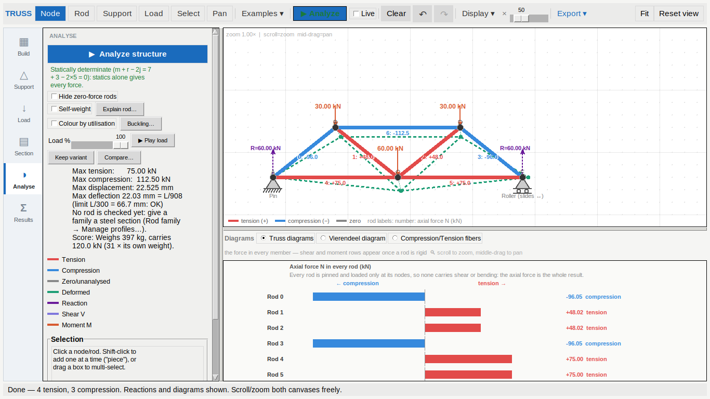
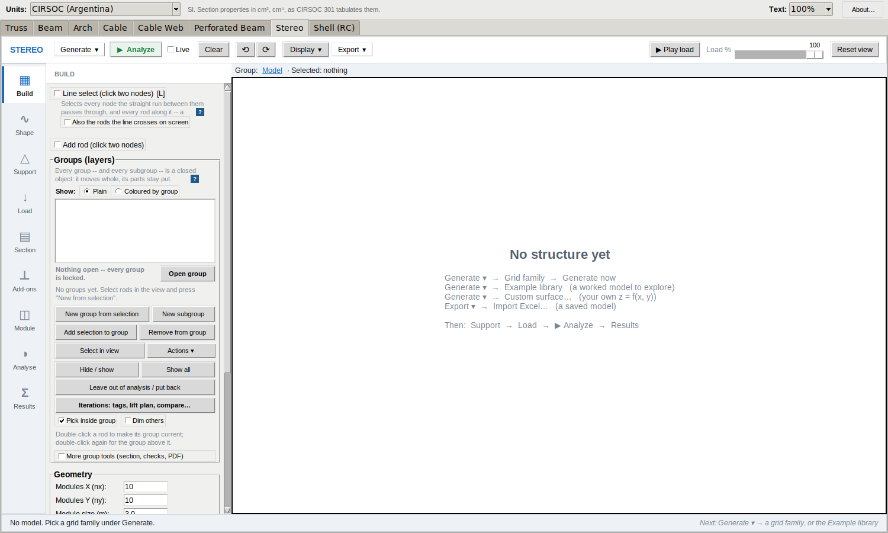
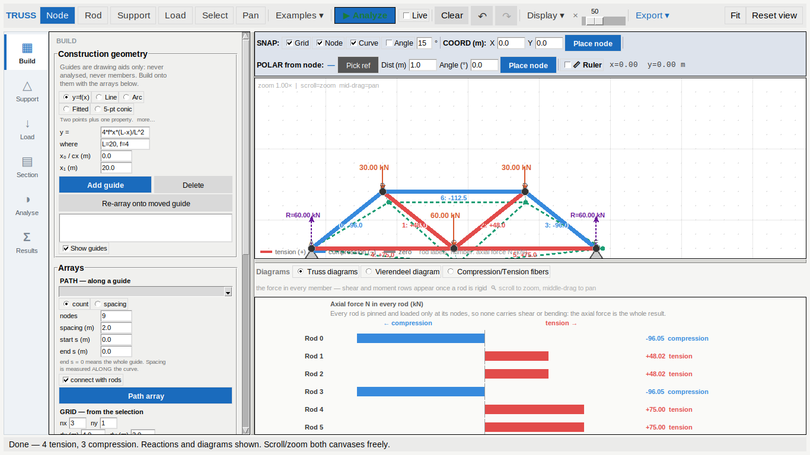

# v32 t 03 · 11-10-26

The third round on v32, and the one the owner asked for in a sentence:

> *can you make the ui and gui look more like the stereo app with the
> buttons for the different groups to the left of the left panel and also
> re arrange the buttons on the top panel to acomodate the same features?*

Two things, then: a **mode rail** down the left edge of the Truss panel,
and a **toolbar in Stereo's order**. Both are shape, not features — no
analysis, no drawing and no export behaves differently after this round.



---

## 1. The mode rail

### What was wrong

The Truss panel was eleven sections in one scroll: Analyze, the stability
line, Live, self-weight, assumed material, connection type, two load
editors, construction geometry, arrays, plates with its gusset bolt grid,
rod families, selection. None was louder than any other, so finding
"where do I put the load" meant reading all of them. `t 01` moved the
panel to the left and made it draggable, and `t 02` made the contents
readable, but neither changed that a student looking for one control had
to scan twelve.

Stereo had already solved it, and this is the model the owner named: you
are doing exactly ONE thing at a time — building the structure, or
restraining it, or loading it, or reading what came out — and only that
thing's controls belong on screen.



### What it is now

`common.ModeRail` — a column of modes down the left edge, exactly one
active, the others `pack_forget`-ed. Six modes in the Truss tab:

| | mode | what is in it |
|---|---|---|
| ▦ | **Build** | construction geometry, arrays |
| △ | **Support** | the support picker and its symbols |
| ↓ | **Load** | point loads, span loads, the load editor |
| ▤ | **Section** | material, connection type, plates, rod families |
| ◑ | **Analyse** | Analyze, stability, self-weight, buckling, Load %, the result |
| Σ | **Results** | rod forces, reactions, the plate table |



Decisions worth recording, because each one had an alternative:

* **The tab opens on Analyse, not Build.** The first thing an
  architecture student wants from this tab is to press the button and see
  what happens; building comes after they have something to look at.
  `TrussApp.DEFAULT_MODE`.
* **Picking a tool takes you to that tool's controls.** The Load tool used
  to leave you to scroll for the Fx/Fy fields. `TrussApp.TOOL_MODE` maps
  Node/Rod → Build, Support → Support, Load → Load.
* **The Selection box is pinned below the rail's frames, not inside one.**
  What is selected is true in all six modes. It is a sibling of the mode
  frames, packed `side='bottom'` *before* them, because pack hands each
  slave its parcel in packing order and a bottom slave registered after an
  expanding one gets nothing.
* **The rail sits OUTSIDE the sash.** `AppShell` gained a `rail_host`
  frame beside the `PanedWindow` rather than inside it. Inside, every drag
  of the panel's edge would have resized the rail too.
* **The frames are unpacked, not lowered.** A hidden frame that is still
  packed keeps claiming width from the drawing, which is the whole cost
  the rail was meant to remove.
* **Alt+1..9** jump straight to a mode and return `'break'`. Alt and not a
  bare digit because half the work in this tab is typing numbers into
  entry fields; the `'break'` because without it Alt+4 would switch mode
  *and* type a 4 into whichever field had focus. The shortcut is named in
  each mode's hover text, which goes to the status bar — a key nobody is
  told about is a key nobody presses.

`ModeRail` lives in `common.py`, not in the Truss tab, so the next tab to
adopt it is the same shape rather than a copy that drifts. Stereo keeps
its own, older version for now.

## 2. The toolbar, in Stereo's order

Stereo's bar reads as a sentence. This one did not. It is now:

```
TRUSS │ Node Rod Support Load Select Pan │ Examples ▾ │ ▶ Analyze  Live │
Clear ↶ ↷ │ Display ▾ × [slider] │ Export ▾ … Fit  Reset view
```

against Stereo's

```
STEREO │ Generate ▾ │ ▶ Analyze  Live │ Clear ↶ ↷ │ Display ▾ │ Export ▾
… ▶ Play load  Load % … Reset view
```

— MAKE it → RUN it → FIX it → LOOK at it → GET IT OUT, with the drawing
tools up front because that is the one thing Truss does that Stereo does
not. Every name that means the same thing in both tabs is now spelt the
same way: `View ▾` became **`Display ▾`**.

Three moves, and all three were needed to get the bar onto ONE ROW at
1366 px, which is the commonest screen this app is opened on:

* **`Advanced tools` moved into `Display ▾`.** It was a lone checkbox in a
  group of its own after Export — the group that pushed the bar onto a
  second row, and an afterthought where it sat rather than a display
  choice.
* **`Live` moved out of the panel** and up beside Analyze, where Stereo
  keeps it. It switches that button on and off, so it belongs next to it
  rather than two rows below. `Hide zero-force rods` stays in the panel.
* **The tool buttons lost `width=7`.** Six buttons padded out to seven
  characters each cost about 150 px of nothing.

### A layout bug this uncovered

`Fit / Reset view` are packed to the RIGHT of the same bar and are not
registered as `FlowBar` groups, so the wrap arithmetic could not see them:
the last group was laid into space they already held, and at 1366 px
`Export ▾` was drawn *underneath* `Fit`. `FlowBar` gained a `reserve`
attribute — the width of a right-packed, unregistered sibling, subtracted
from what the rows may use. `test_nothing_on_the_bar_is_drawn_under_the_camera_buttons`
measures it at four widths.

## 3. What the restructure broke, and what that cost

Moving fifteen sections out of one flat panel into six frames broke four
things, all caught by the suite, all now fixed:

* **`_fold_long_hints` folded almost nothing.** It is called with the
  frame the mixin was handed, which is now the Analyse mode's frame — so
  every long grey hint in the other five modes stayed unfolded. It is
  called on the whole panel interior now.
* **`test_truss_layout.py` measured one sixth of the panel.** Its premise
  — every control mapped at every width — is false by design under a mode
  rail. The sweep now runs once PER MODE (`@pytest.mark.parametrize`),
  reading the mode list off `TrussApp.MODES` so a seventh mode cannot be
  added without being covered, and the inactive frames' controls are
  subtracted precisely rather than the assertion being softened.
  `_deliberately_hidden` returns the SIZE OF A SET rather than a running
  total: the construction-geometry rows live inside the Build frame, so
  while another mode shows they are hidden for both reasons and adding the
  two counts subtracted nine controls that only exist once.
* **`test_the_tab_opens_simple_and_advanced_restores_every_section_in_place`**
  compared one flat pack order that no longer exists. It now checks
  (parent, index) per section across a full Advanced → Simple → Advanced
  round trip, which is a stronger claim than the version it replaced.
* **A `sed` replaced one line in two classes.** The `available = ...` edit
  meant for `FlowBar.relayout` also landed in `WrapBar.relayout`, which
  has no `_reserved`; Beam, Arch and Cable lost their toolbar layout
  entirely. Six failures in `test_tab_layouts.py`, fixed in minutes
  because that file exists.

## 4. Tests

`tests/test_mode_rail.py` is new — 19 tests:

* the rail: one frame shown and the rest UNPACKED, `register` puts a
  late frame away, `on_change` fires once per selection, an unknown key
  changes nothing, `label_of`, the rail's fixed width, the rail left of
  its frames, `AppShell.rail_host` outside the `PanedWindow`;
* the hotkeys: Alt+1..9 in rail order, and the `'break'` measured by
  focusing an Entry and checking nothing was typed into it;
* the Truss tab's use of it: one mode at a time with the title to match,
  opens on Analyse, each tool reaches its own controls, Selection pinned
  below every mode, Analyze within 120 px of the top of its mode;
* the toolbar: one row at 1366 px, still wraps at 800 px, nothing drawn
  under the camera buttons at 1600/1366/1200/1000 px.

**Measured, 11-10-26**, Python 3.12 under Xvfb at 1600x1000:

```
pytest tests/ --ignore=tests/test_stereo_app.py
    3004 passed, 1 skipped in 570.24s
```

against 2980 passed / 1 skipped at the end of `t 02` — the 24 added are
the 19 new ones plus the five extra parametrized runs of the layout
sweep, one per mode, in place of the single run it replaced.
`tests/test_stereo_app.py` (1000 tests, about two hours on this machine)
is run separately; its figure is recorded when it finishes.

`test_selection_is_pinned_below_every_mode_rather_than_inside_one`
deliberately does NOT assert `winfo_ismapped()`: inside a `ScrollPanel`
every widget stays mapped whether or not it has been scrolled past, so
that check would pass on a box nobody can see. It asserts the structure
and the drawn position instead.

## 5. Files

| file | change |
|---|---|
| `common.py` | `ModeRail`; `AppShell.body_host` / `.rail_host`; `FlowBar.reserve` and `_reserved()` |
| `apps/truss/truss_app.py` | `MODES`, `DEFAULT_MODE`, `TOOL_MODE`; `_build_panel` into six mode frames; `_on_mode_change`, `_on_mode_hint`, `_show_mode`; toolbar reordered and renamed |
| `apps/truss/truss_app_learn.py` | `_build_learn_toolbar` is state-only; `Live` moved to the bar; `_fold_long_hints` over the whole panel; `_next_packed_after` is parent-aware |
| `tests/test_mode_rail.py` | new, 19 tests |
| `tests/test_truss_layout.py` | swept per mode; `_hidden_by_mode` |
| `tests/test_truss_learn.py` | per-parent slot check; the fold test brings its hint on screen first |
| `USER_GUIDE.html` | `Advanced tools` is under `Display ▾` |
| `tools/build_release.py`, `BUILD_STAMP.txt` | `APP_ITERATION = 3` |
