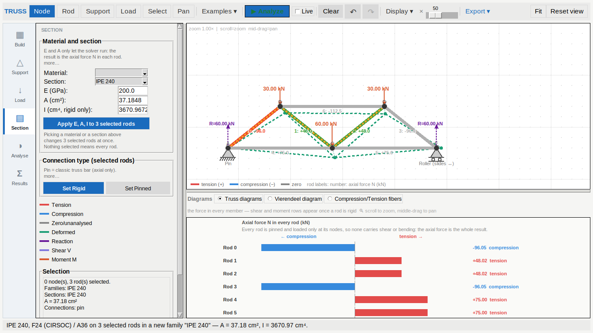
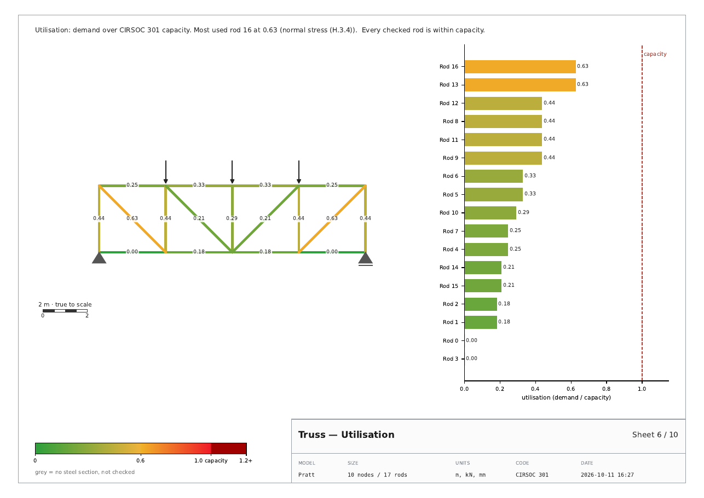
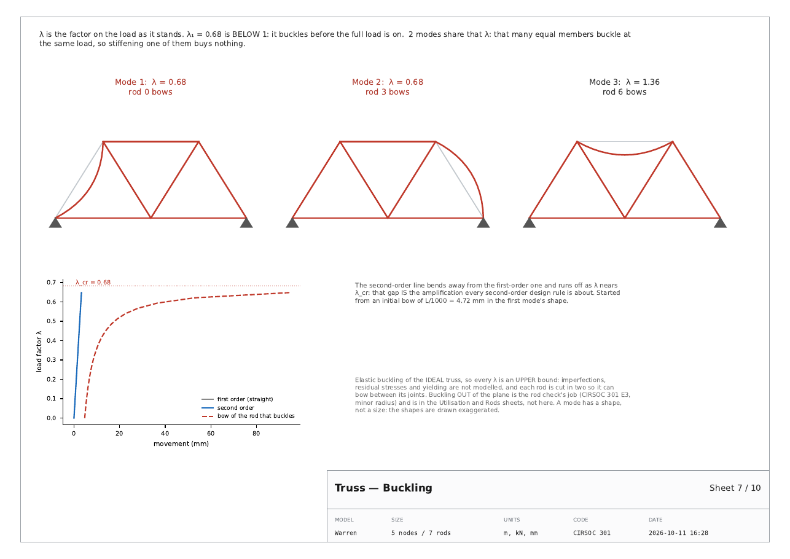

# v32 t 04 · 11-10-26

Two things the owner asked for:

> *add to the truss pdf the utilization and the buckling under the three
> variations of lambda. Also im not sure the section tab is working
> properly, when im trying to select an array of rods and apply a new
> section the array does not update properly and the information does not
> change can you fix it please?*

The second one was a real bug, and a bad one. It is first.

---

## 1. The Section tab applied to nothing

### What was wrong

The Section panel's **"Assumed material (all rods)"** box applied to **no
rods at all**. `mat_E`, `mat_A` and `mat_I` are read in exactly two
places in the whole tab, and both of them are rod *creation*:

```
truss_app.py:1949   'E': self.unit_value(self.mat_E), ...   # a new rod
truss_app.py:3054   'E': self.unit_value(self.mat_E), ...   # an arrayed rod
```

So selecting three rods and picking "IPE 240" did this:

```
A before : [10, 10, 10, 10, 8, 8, 8]
chosen   : IPE 240
A after  : [10, 10, 10, 10, 8, 8, 8]
status   : IPE 240 — A = 39.10 cm², I = 3892.00 cm⁴ (strong axis).
results  : still solved
```

— nothing changed, the results were left standing so no number on screen
moved, and the status bar announced the new section as though it had
landed. The frame's own title said *all rods* while applying to none. The
report was exact: *"the array does not update properly and the
information does not change."*

### What it does now



Everything in the box reaches the rods, and the box says which rods:

* **the target is the selection**, or every rod when nothing is selected.
  One function, `_material_target()`, decides it, so the button label, the
  hint under it and the action cannot disagree. The button reads
  *"Apply E, A, I to 3 selected rods"* and relabels itself as the
  selection moves;
* **picking a Material or a Section applies immediately** — that is the
  gesture that was reported, and a combobox is a deliberate, discrete
  choice. Hand-typed E / A / I go through the button, because a
  `<FocusOut>` that rewrites whatever happens to be selected is worse
  than a click;
* **the whole section, not just A and I.** A rod is only checked once it
  has `Fy` and a radius of gyration, and those live on its *family*
  (`truss_design.member_for`). Writing A and I alone would have moved the
  forces and still left every utilisation reading "no steel section" —
  its own silent failure. The three rods above are now `checked: True`;
* **the truss is re-solved**, not merely invalidated. "The information
  does not change" is not fixed by showing none;
* **the Selection box names the section** (and the areas), because that
  is what the reader looks at to see whether anything happened. It said
  only the family before, which is identical before and after.

### Families: why it is not a one-liner

A section lives on a **family** here, not on a rod. Writing "IPE 240"
onto `Default` when three of its seven rods are selected would silently
re-section the other four. So:

| selection | what happens |
|---|---|
| a **whole** family | that family takes the section — no new family for nothing |
| **part** of one | those rods move into a family of their own, named after the section |

Applying the same section twice to different selections gets
`IPE 300` and `IPE 300 (2)`, never a silent merge.

### One table, not two

`SECTION_PRESETS` carried its own hand-copied A and I, and that second
table disagreed with `apps/stereo/stereo_profiles` by **3–5 %** — the
catalogue computes from the plate geometry and has no root fillets:

| | preset A | catalogue A | preset I | catalogue I |
|---|---|---|---|---|
| IPE 240 | 39.10 | 37.18 | 3892 | 3671 |
| IPE 300 | 53.80 | 51.88 | 8356 | 7999 |

Two numbers for one section is one too many, and a handbook area paired
with the catalogue's own radius of gyration inside one CIRSOC check is
not a section that exists. The preset list is **names only** now and
every property comes from the catalogue, which is what the check reads.

### What is allowed, and said out loud

Typing an area over a catalogue section is a fair thing to try, so it is
still allowed — but the check would then pair that area with the
section's `r_gyr`. The status bar says so when it happens, and the
Selection box marks the rod **"IPE 240 (A overridden)"** rather than
showing a section the rod no longer has.

## 2. Utilisation in the PDF



The rod table already carried utilisation as a column of numbers, and a
column of numbers is not how anyone finds the rod that is in trouble.
The new sheet is the same information as a picture: the truss in the
tab's own green–amber–red ramp with each rod's figure on it, and the
rods ranked beside it so the worst one is the top bar, with the capacity
line drawn at 1.0.

* the caption names the governing rod and its check, and lists every rod
  **over** capacity;
* rods whose family has no steel section are **grey**, and the caption
  counts them — "no section" is a state of the model the reader has to
  know about, not a gap in the drawing. With no sections at all the sheet
  says so instead of showing a blank;
* the ramp is now `truss_design.util_color`, shared with the canvas, so a
  sheet and the screen cannot disagree about what amber means.

## 3. Buckling, under the three λ



The three lowest buckling factors with their shapes, and the
second-order load–deflection curve — what the Buckling window has shown
since it landed, now in the report.

**Why three and not one.** One number ("it buckles at 3.5×") says whether
there is room. Three say how much room there is *between* the modes, and
that is a design reading rather than a number:

* 3.55, 3.55, 3.55 (the Pratt) — equal eigenvalues are not a numerical
  accident: four identical compressed members buckle at one load.
  Stiffening one of them buys nothing. The sheet says that, rather than
  printing the same figure three times and letting it look broken;
* 0.68, 0.68, 1.36 (the Warren) — λ₁ **below 1**, called out in red on
  the headline and on the two mode titles: it buckles before its own load
  is on.

Each panel names what moves ("rod 12 bows", "node 4 moves most") and the
shapes are drawn as quadratic Béziers through the rod mid-points, so a
bowing rod reads as a bow and not as two straight segments.

The sheet says, in as many words, that this is **elastic buckling of the
ideal truss and every λ is an upper bound** — imperfections, residual
stresses and yielding are not modelled — and that buckling *out* of the
plane is the rod check's job and lives on the Utilisation and Rods
sheets. A sheet that hands an architecture student "3.5" without those
sentences is teaching a number they will believe.

Buckling is computed inside `truss_pdf.buckling_for()` rather than taken
from the window, so a report written by a script has the same sheets as
one exported from the app. It costs one eigenproblem on a few hundred
degrees of freedom; `export_pdf(..., buckling=False)` skips it.

### A frame bug found on the way

`matplotlib`'s own `wrap=True` wraps at the **figure** edge, and these
sheets have a drawn frame 2.6 % inside it — so an auto-wrapped caption
runs its first line over the rule and off the paper. `_wrap()` wraps at a
given width instead, and
`test_every_caption_stays_inside_the_drawn_frame` measures every
caption's rendered box against `stereo_reports.PDF_FRAME`.

## 4. Tests

`tests/test_truss_section_apply.py` is new — 15 tests over the reported
bug: the selected rods change and the unselected ones do not, they become
*checked*, the truss is re-solved, the status bar says what happened, a
partial selection gets its own family, a whole family keeps its name,
names do not collide, the button follows the selection, the Selection box
names the section, an override is announced, materials reach the rods,
and undo puts it all back.

`tests/test_truss_pdf.py` gains 12: both sheets present and paginated,
the ranking worst-first and agreeing with `td.governing`, the shared
colour ramp, an over-capacity rod named, unchecked rods counted, three
ascending λ each drawn and labelled, λ < 1 called out, the upper-bound
sentence present, equal λ explained, no-compression handled, the
`buckling=False` switch, and the frame check above.

**Measured, 11-10-26**, Python 3.12 under Xvfb at 1600x1000, after every
change in this round:

```
pytest tests/ --ignore=tests/test_stereo_app.py
    3032 passed, 1 skipped in 559.57s
```

against 3004 passed / 1 skipped at the end of `t 03` — the 28 added are
15 + 12 new ones plus the catalogue-names check.

Two `t 02` tests were rewritten rather than deleted:
`test_a_section_preset_fills_A_and_I` and
`test_sections_grow_monotonically` read the catalogue now, so the two
tables can no longer drift apart.

## 5. Files

| file | change |
|---|---|
| `apps/truss/truss_app.py` | `_material_target`, `_refresh_material_target`, `_after_section_change`, `_apply_material_to_rods`, `_apply_section_to_rods`, `_free_family_name`, `_section_AI`, `_rod_section_name`; `_apply_material_preset` / `_apply_section_preset` rewritten; `SECTION_PRESETS` is names only; `PRESET_STEEL`; the frame retitled and given a button and a hint; `_show_sel` names sections |
| `apps/truss/truss_design.py` | `util_color` moved here, out of the Tk module |
| `apps/truss/truss_app_design.py` | re-exports `util_color` from there |
| `apps/truss/truss_pdf.py` | `utilisation()`, `_util_key()`, `buckling()`, `_draw_mode()`, `_load_deflection()`, `buckling_for()`, `_wrap()`; `export_pdf` gains `buckling=` and returns `utilised` / `buckling` |
| `tests/test_truss_section_apply.py` | new, 15 tests |
| `tests/test_truss_pdf.py` | +12 tests |
| `tests/test_truss_tier3.py` | the two preset tests read the catalogue |
| `USER_GUIDE.html` | the new sheets, and how to give rods a section |
| `tools/build_release.py`, `BUILD_STAMP.txt` | `APP_ITERATION = 4` |
