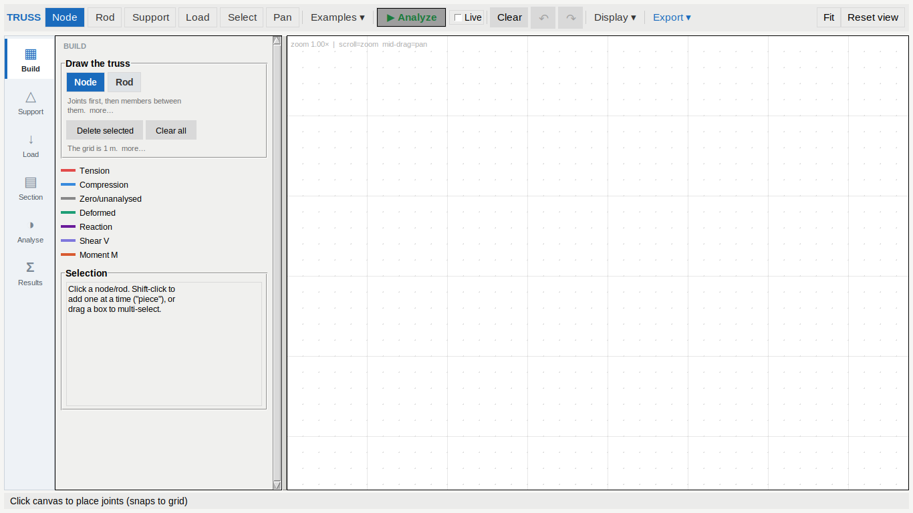
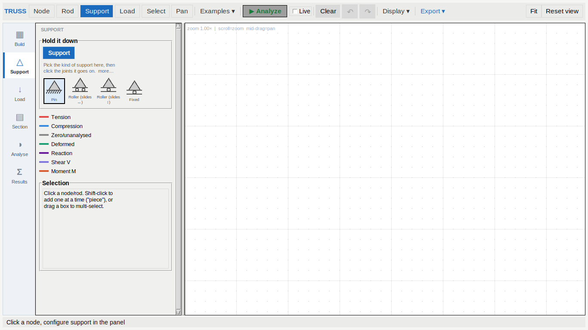
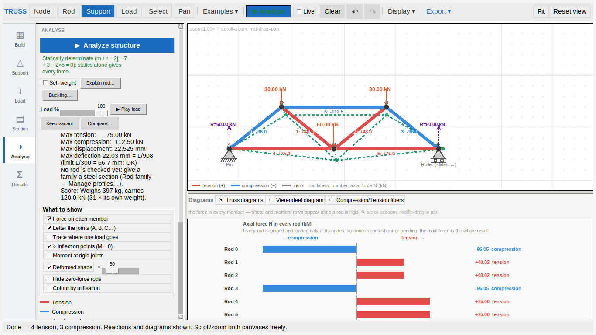

# v32 t 05 · 11-10-26

Two reports from the owner, both about the mode rail that landed in
`t 03`:

> *The support tools and the rod and node tools do not appear in their
> respective tabs in the basic or advanced modes. Also most of the tools
> of the "display" except for the advanced tools toggle should be in the
> analyze tab*

---

## 1. Four of the six modes were empty

### What was wrong

The rail's modes were filled by *moving existing sections into them*, and
the sections that existed were the per-click editors and the
Advanced-only extras. Nothing was written for the modes themselves. So,
measured — packed top-level sections per mode:

| mode | Simple | Advanced | |
|---|---|---|---|
| Build | **0** | 2 | Node and Rod had no controls at all |
| Support | **0** | **0** | empty in BOTH |
| Load | **0** | 2 | |
| Section | 2 | 4 | |
| Analyse | 8 | 8 | |
| Results | **0** | **0** | until something was solved |

Picking the Node tool took you to a Build pane with nothing in it. The
Support pane was blank in *both* Simple and Advanced, because the support
type picker lived inside the "Support on node —" editor, which is
`pack_forget`-ed until you click a joint — so the control that tells you
what to click was hidden until after you had guessed.

A mode the rail can take you to and leave blank is worse than no rail at
all: it reads as a broken tab.

### What it is now

Every mode opens with a card naming **its own tools, as buttons that pick
them**, and one line saying what to do with them. The per-click editors
still appear underneath when a joint is picked.



* **Build — "Draw the truss"**: Node and Rod, the note that joints come
  before members, *Delete selected* / *Clear all*, and what Advanced
  tools would add (the CAD bar, construction geometry, arrays).
* **Support — "Hold it down"**: the Support tool, and the four support
  symbols, now **always on screen**. Picking which kind of support you
  are placing is a setting of the tool, not a property of a joint you
  have not clicked yet.
* **Load — "What it carries"**: the Load tool and where span loads live.
* **Results**: "Nothing solved yet" and what to press, replaced by the
  result boxes the moment there are any.



The panel's tool buttons are **the same tools**, not a second set: they
call the same `_set_tool` and are lit by the same
`_refresh_tool_buttons`, so the toolbar and the panel cannot disagree
about which tool is active. They are repeated because the toolbar says
what the tab can do and the panel says what *this mode* is for, and a
beginner reads the panel.

### Two smaller things found with them

* **The support symbols were captioned twice.** `_draw_support` writes
  the name onto the canvas and the picker cell packs a label under it, so
  each symbol said "Pin" twice with the canvas copy clipped by the bottom
  edge. `_draw_support(..., label=False)` for the picker.
* **The Selection box was blank on a fresh tab.** Its "Click a node/rod…"
  text is written by `_show_sel`, which until now first ran on the first
  click — the one moment you did not need telling.

## 2. The display switches moved into Analyse



`Display ▾` held six switches you could see one at a time, three rows
above the result they describe. They are a **"What to show"** box in the
Analyse panel now, all eight at once:

| | |
|---|---|
| Force on each member | Letter the joints (A, B, C…) |
| Trace where one load goes | ○ Inflection points (M = 0) |
| Moment at rigid joints | Deformed shape **× [scale]** |
| Hide zero-force rods | Colour by utilisation |

That is where you are standing when you want them: you press Analyze,
look at the result, and *then* ask to see the deformed shape. Reaching
back up to a toolbar menu to change what the drawing in front of you
shows is a trip.

Two switches joined them from elsewhere in the same panel —
`Hide zero-force rods` (it was beside the stability line) and
`Colour by utilisation` (it was beside the Buckling button). Both change
what is *drawn*, so one box holds everything that does.

**The deflection scale came with it.** The `×` slider was at the far end
of the toolbar from the menu holding the switch it magnifies; it now sits
on the same row as *Deformed shape*. The number is meaningless without
the switch and the switch is hard to read without the number.

`Display ▾` keeps **`Advanced tools`**, as asked: that one is not about
what is drawn, it is about which controls exist, and it has to be
reachable from every mode including the ones it adds sections to. The
menu also carries a line pointing at where the rest went, so anyone who
opens it looking for "Deformed shape" is told rather than left hunting.

Side effect: the toolbar gave back the `×` label and the slider, about
100 px, so it has more room at 1366 px than it did in `t 03`.

## 3. Tests

`tests/test_mode_rail.py` grows from 19 to 42. The new ones:

* **no mode is ever empty**, parametrized over Simple *and* Advanced —
  the measurement from the table above, as an assertion;
* each tool has a button in its own mode, which selects that tool and
  switches the rail there; the panel's buttons light with the toolbar's;
* the support picker is visible **before** any joint is clicked, and the
  symbols are not captioned twice;
* Results says what is missing before a solve and hides it after;
* the Selection box explains itself on a fresh tab;
* `Display ▾` keeps only `Advanced tools`, and each of the eight display
  switches is in the Analyse panel and mapped;
* the deflection scale is on the same row as its switch and drives
  `def_scale`;
* ticking a switch in the panel still redraws.

**Measured, 11-10-26**, Python 3.12 under Xvfb at 1600x1000:

```
pytest tests/ --ignore=tests/test_stereo_app.py
    3055 passed, 1 skipped in 572.67s
```

against 3032 passed / 1 skipped at the end of `t 04`.

## 4. Files

| file | change |
|---|---|
| `apps/truss/truss_app.py` | `_build_mode_card`, `_build_card_extra`, `_show_results_placeholder`, `mode_tool_btns`; cards for Build / Support / Load; the support picker moved into the Support card; `_draw_support(label=)`; the `What to show` box; `Display ▾` reduced to `Advanced tools`; `_show_sel()` on startup |
| `apps/truss/truss_app_learn.py` | `Hide zero-force rods` moves into `What to show` |
| `apps/truss/truss_app_design.py` | `Colour by utilisation` moves into `What to show` |
| `tests/test_mode_rail.py` | 19 → 42 tests |
| `USER_GUIDE.html` | the mode cards and where the display switches live |
| `tools/build_release.py`, `BUILD_STAMP.txt` | `APP_ITERATION = 5` |
