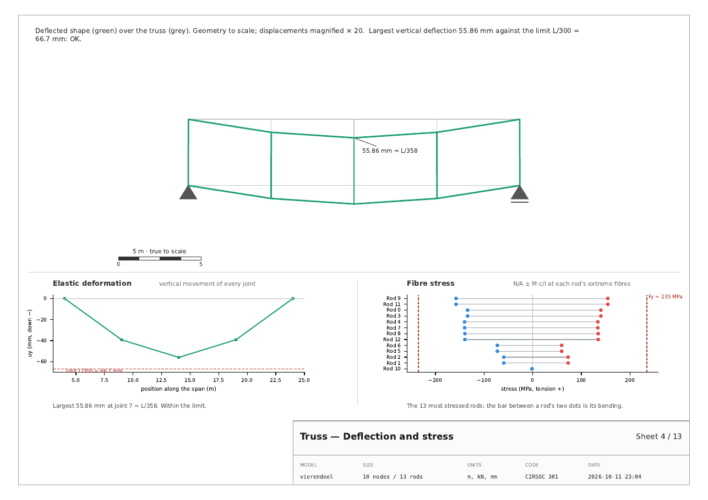
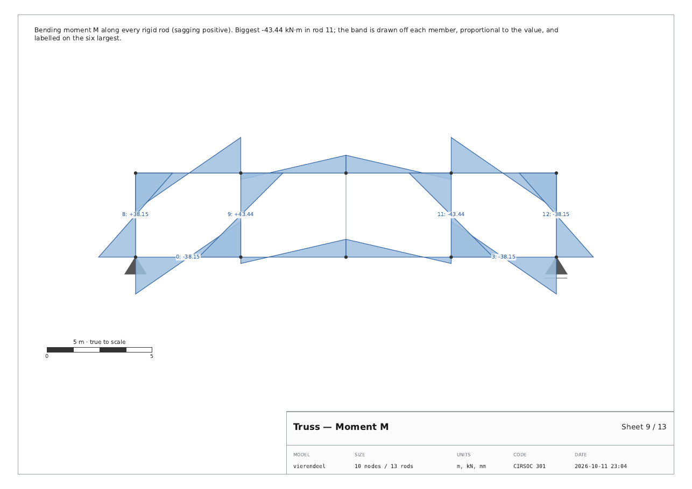
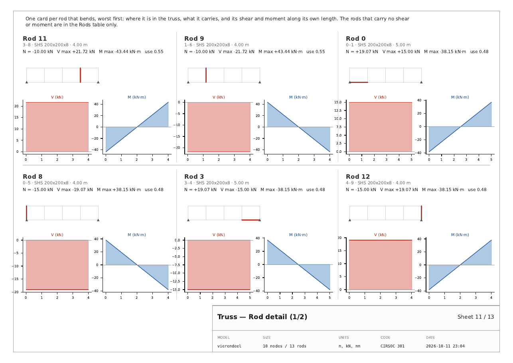
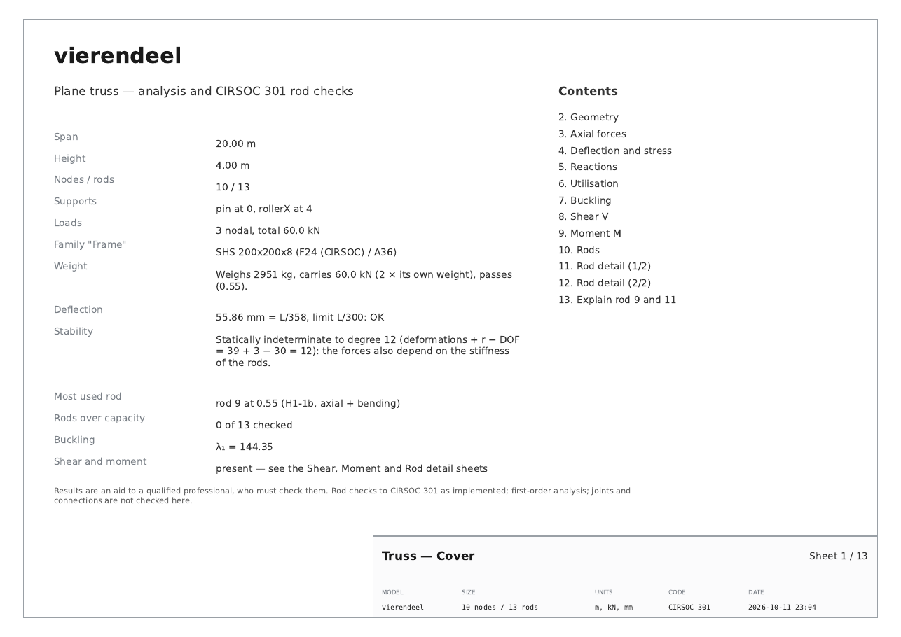

# v32 t 06 · 11-10-26

> *also in the pdf i would like all features of the analyze button to be
> in the document, but trying to use the least amount of pages. The rod
> analysis can be reduced grouping some rods in the same sheet with
> divisors to distinguish them also add a picture of the specific rod in
> the context of the truss to make sure we know what we are talking
> about. The deformation graph with the elastic deformation graph and
> the fiber stress graph could be all in the same sheet separated by
> divisors. The momentum and shear diagrams should be in distinct sheets
> in case the size of the truss makes it harder to distinguish the
> diagrams. But another sheet with the per rod report and their moment
> and shear diagrams.*

Both halves of that at once: **everything ▶ Analyze produces**, and
**fewer sheets than before**.

| | before | after |
|---|---|---|
| Pratt (pinned) | 10 | **9** |
| Vierendeel (rigid) | 10, missing four subjects | **13**, complete |

---

## 1. What was missing

▶ Analyze computes the axial forces, the deflected shape, the reactions,
the CIRSOC checks, the shear and moment diagrams, the fibre stress, the
stability verdict, the plate checks and the score. **Four of those were
not in the report at all**:

* the **shear and moment diagrams** — the whole Vierendeel side of the
  tab, with nothing on paper;
* the **fibre stress** — likewise;
* the **stability verdict** — the line the tab prints before you even
  solve ("statically indeterminate to degree 12…");
* the **plate checks**.

And the deflection was a single number in a caption.

## 2. What was wasteful

Every sheet had one subject whether or not it had anything to say, and
the step-by-step checks took **one rod per sheet** — a column of
monospace down the left half of a landscape A4 with the right half
empty.

## 3. The sheets now

### Deflection and stress — three graphs, one sheet



The deflected shape, the **elastic deformation** curve through every
joint against the L/300 limit, and the **fibre stress** of every rod
(N/A ± M·c/I at its two extreme fibres), divided by a rule across and a
rule down.

One sheet because they are one question. The shape says *where* it
moves, the curve says *how much* against the limit — a single number
cannot tell you whether a truss sags evenly or dips at one panel point,
which is the difference between a member that is too small and a truss
that is too shallow — and the fibre stress says what that costs the
steel. A pinned rod's two fibres coincide, and the panel says so rather
than drawing one dot and leaving the reader to wonder.

### Shear and Moment — a sheet each



Drawn as silhouette bands off each member, in the tab's own convention
(local transverse axis `(-dy/L, dx/L)`, split at every sign change so a
lobe crossing zero is two polygons and not a bow-tie), with the six
largest labelled.

**Two sheets and not one**, as asked: the tab draws them side by side,
which halves the width each gets. On a long truss that is the difference
between reading a lobe and guessing at it, and on paper there is no
reason to pay it.

### Rod detail — a card per rod, six to a sheet



Worst first. Each card carries **a thumbnail of the whole truss with
that rod in red**, its numbers (N, V max, M max, utilisation) and its
own V and M along its length, with rules dividing the cards.

The thumbnail is the part that was asked for and it earns its space:
"rod 13 is at 0.63" is a sentence about a rod the reader cannot place.
On a 17-rod Pratt there is no way to know which member that is without
counting along the Geometry sheet, and on a 60-rod model nobody does.

This is the sheet the Rods *table* cannot be. A table row gives the peak
of V and M; a card gives their **shape**, which is what tells you whether
a rod bends in single or double curvature.

### Explain — two rods to a sheet, with thumbnails

Halves the page count and loses nothing. Each column gets the same
thumbnail treatment and its verdict in the heading, so the truncation
note at the foot of a very long check never swallows the answer.

### Plates — a sheet that usually does not exist

Gusset and shear-panel checks, when the model has plates. A panel's
shear-**buckling** utilisation is printed beside its yield one, never
alone: a thin plate buckles long before it yields, so a comfortable tau
on its own is the most misleading number this feature can produce.

### Cover — the whole verdict on page one



Stability, the most used rod and its governing check, how many rods are
over capacity, λ₁, the plate summary, and whether there is any shear or
moment at all — plus the contents, which now lists **the sheets that
were actually built**.

That last one needed the build order inverted: the cover is written
LAST and moved to the front. Writing it first meant it could only
describe what was known before the report existed, which is how it came
to promise a fixed menu of sheets and to omit the stability line.

## 4. Fewer pages, by skipping what would be blank

A classic truss — every rod pinned, every load at a joint — has **no
shear and no moment anywhere**: the axial force is the whole result,
which is the single most important thing this tab teaches. Shear, Moment
and the per-rod cards would be three or four sheets of flat zero lines
that say nothing and bury the sheets that do.

So they are produced **only when something bends**, and the cover says
so in as many words instead. Same for Plates. That is where the Pratt's
page count goes *down* while gaining the stability line, the elastic
curve and the fibre stress.

## 5. Tests

`tests/test_truss_pdf.py` goes from 23 to 43. The new ones:

* a pinned truss gets no Shear, no Moment and no Rod detail, and ≤ 10
  sheets — the "least amount of pages" instruction as one assertion;
* a bending model gets all three, and the page count matches the PDF's
  own `/Type /Page` count;
* Shear and Moment get a full-width sheet each, the bands are drawn, and
  the biggest is labelled;
* Deflection and stress is one sheet with three graphs and both kinds of
  divider rule; the elastic curve plots every joint and draws the limit;
  the fibre panel says a pinned rod has no bending to show;
* every rod card carries a thumbnail picking out exactly one rod; cards
  carry their own V and M; they are ordered worst first; rods that carry
  nothing get no card;
* two rods share an Explain sheet with their thumbnails, and no column
  runs under the title block;
* the cover reports the stability verdict, the governing rod, λ₁ and the
  shear/moment note, and lists the sheets that exist;
* the plate sheet never hides the buckling utilisation, and an unchecked
  plate says why instead of leaving a blank row.

**Measured, 11-10-26**, Python 3.12 under Xvfb at 1600x1000:

```
pytest tests/ --ignore=tests/test_stereo_app.py
    3075 passed, 1 skipped in 545.43s
```

against 3055 passed / 1 skipped at the end of `t 05`.

## 6. Files

| file | change |
|---|---|
| `apps/truss/truss_pdf.py` | `bends`, `draw_band`, `_action_sheet`, `shear`, `moment`, `deflection_and_stress`, `_elastic_curve_panel`, `_fibre_stress_panel`, `_deformed_panel`, `thumbnail`, `rod_detail`, `_rod_card`, `plate_table`, `_hrule`, `_vrule`, `EXPLAIN_LINES`; `explain` grouped two to a sheet; `cover` carries the verdict and is built last; `export_pdf` takes `diagrams` / `plates` / `plate_checks` / `stability` |
| `apps/truss/truss_app_design.py` | hands the report what ▶ Analyze already computed, and says in the status bar which sheets were left out |
| `tests/test_truss_pdf.py` | 23 → 43 tests |
| `USER_GUIDE.html` | what the report now contains |
| `tools/build_release.py`, `BUILD_STAMP.txt` | `APP_ITERATION = 6` |
