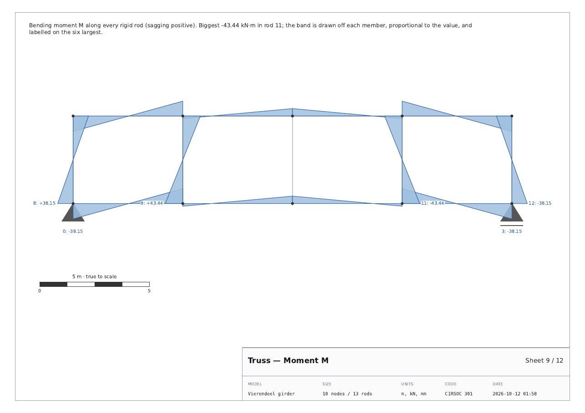
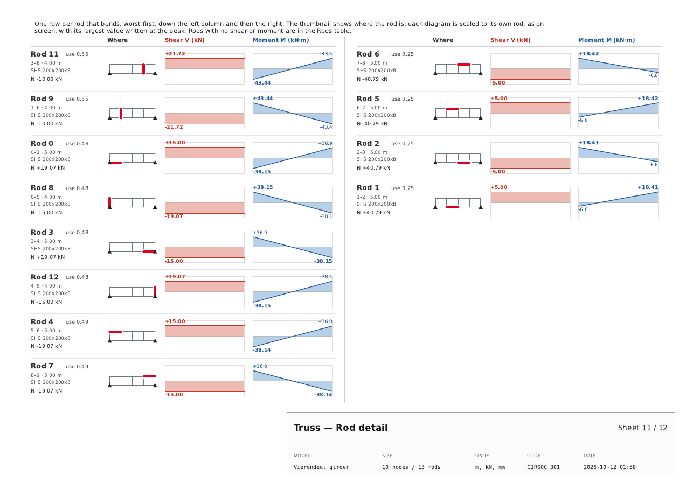
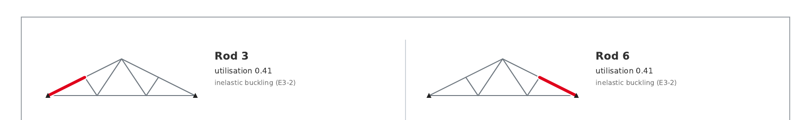

# v32 t 07 · 12-10-26

> *please re check the changes that you made, make sure the graphs of the
> rods and in the vierendeel case are scaled and do not occupy too much of
> the sheet. even if the amount of rods is big or small … i prefer similar
> scales to the ones in the display … plus the pictures of the references
> of position of the rods need more contrast. after fixing this please
> provide me with the pdfs of the examples*

A correction to `t 06`. The owner was right on all three counts, and the
measurements below say by how much.

---

## 1. The Shear and Moment lobes were 2–3 times the screen's

### Measured

The tab's Vierendeel view puts its biggest lobe at `0.16 ×` the smaller
canvas dimension. On the Vierendeel example that comes to:

| window | truss drawn | lobe | of the width | of a bay |
|---|---|---|---|---|
| 1366 × 768 | 386 px | 19.7 px | **5.1 %** | 20 % |
| 1920 × 1080 | 662 px | 23.8 px | **3.6 %** | 14 % |

`t 06` used **10 % of the span** — two to three times that. On a
Vierendeel, where every bay bends, the lobes of neighbouring members
reached into each other.

### Now

`_Report.band_reach()` — the smaller of

* **4 % of the span**, the middle of what the screen draws, for a truss
  of a few long members; and
* **20 % of the median member length**, for a truss of many short ones,
  where 4 % of a long span would still be wider than a bay.

The median and not the shortest, so that one short stub does not shrink
every lobe in the drawing to nothing. Checked on three very different
models:

| model | rods | lobe | of the width | of a typical member |
|---|---|---|---|---|
| Vierendeel example | 13 | 0.80 m | 4.0 % | 16 % |
| 12-bay Vierendeel | 37 | 0.60 m | 1.7 % | 20 % |
| portal frame | 3 | 0.24 m | 4.0 % | 6 % |



With the lobes that much smaller, the drawing's margin could come in from
`0.24` to `0.10` of the span (the wide margin is for dimension lines and
load arrows, which these sheets do not carry), so a long truss uses the
width of the sheet instead of a strip across its middle — the lobes keep
their proportion to it.

The labels moved too. They sat at each member's **midpoint**, which on a
Vierendeel member is exactly where the moment crosses zero — the one
point of the rod with nothing to report. They are written **at the peak,
just past the tip of the lobe**, as the screen writes them; a value that
does not change along the rod (constant shear) has no peak and is
labelled at mid-length, outside its own band.

## 2. The rod charts were a seventh of the sheet each

`t 06` gave each rod a card — three across, two down — with V and M
charts 0.14 of the sheet wide and 0.15 tall. Six rods to a sheet, and
each rod's charts bigger than the truss drawing they belong to.

The screen draws **one row per member**, with V and M panels of
330 × 128 px — **2.6 : 1**. The Rod detail sheet does the same now:



* **one row per rod**: its numbers, where it is, its V, its M;
* **two columns of eight**, sixteen rods to a sheet. One column gave
  panels of 4.3 : 1, a long thin strip; two bring them to **2.5 : 1**,
  the screen's own proportion, and halve the sheet count (a 37-rod
  model: 5 sheets → 3);
* each panel **scaled to its own rod**, as on screen, with the peak
  written at the peak — so the size of a curve is never mistaken for the
  size of the force — and the joint value at the other end when it says
  something the peak does not;
* no tick labels: at this size they were most of the ink and none of the
  information;
* column headings once per column, as a table has, instead of a title
  over every chart.

The Vierendeel example's twelve bending rods now take **one** sheet.

## 3. The position thumbnails had no contrast

The rest of the truss was `#cdd3d8` at 0.7 pt against the rod in
`#c0392b` at 2 pt. On screen it looked fine; on paper the truss was
barely there and the red did not stand out from it.



Now the rest of the truss is `#6f7880` at 1 pt — a grey that survives a
laser printer — and the rod `#e0001b` at **3 pt**, drawn **last** and
over a white casing, so that where it meets other members at a joint it
is never the one that disappears. Supports are black. The same
thumbnail serves the Rod detail rows and the Explain sheets.

## 4. Found on the way

* **The Rods table now runs two halves side by side.** It is under half
  the sheet wide, so a model just past 26 rods got a second sheet
  carrying eleven rows and nothing else.
* **A mechanism said "Analyze the truss first".** The *One diagonal
  missing* example is a mechanism by design — it cannot be solved, so
  there is no report — and telling someone who just pressed Analyze to
  press Analyze sends them round in a circle. It now says the truss is a
  mechanism, prints the stability line, and says what would fix it.

## 5. The example reports

`REPORTS AND GUIDES/example_reports_v32_t07/` — every library example,
loaded, solved and exported through the app exactly as a student would:

| | example | sheets | |
|---|---|---|---|
| 01 | Warren | 9 | |
| 02 | Pratt | 9 | |
| 03 | Howe | 9 | |
| 04 | King-post | 9 | |
| 05 | Fink | 9 | |
| 06 | Wall bracket (cantilever) | 9 | |
| 07 | Vierendeel girder | 12 | the only one that bends: Shear, Moment, Rod detail |
| — | One diagonal missing | — | a mechanism; no report, by design |
| 09 | One load, many idle rods | 9 | |

## 6. Tests

`tests/test_truss_pdf.py` goes from 43 to 52:

* the lobe never exceeds 4 % of the span or 20 % of the typical member,
  on a 1-, 4- and 12-bay model;
* the biggest lobe **as drawn** — measured perpendicular to its own
  member on the drawing, not read off the formula — equals the reach;
* every Rod detail panel is between 2 : 1 and 3.2 : 1 and well under a
  hundredth of the sheet;
* sixteen rods fit one Rod detail sheet;
* the thumbnail grey is dark enough to read, the rod a strong red, at
  least 2.5 × thicker, drawn on top and over a white casing;
* the two halves of the Rods table do not overlap;
* a mechanism says why there is no report, and writes no file.

**Measured, 12-10-26**, Python 3.12 under Xvfb at 1600x1000:

```
pytest tests/ --ignore=tests/test_stereo_app.py
    3084 passed, 1 skipped in 577.24s
```

against 3075 passed / 1 skipped at the end of `t 06`.

## 7. Files

| file | change |
|---|---|
| `apps/truss/truss_pdf.py` | `band_reach`; the action sheets at pad 0.10 with a strip for the scale bar, labels at the peak; `rod_detail` rebuilt as rows, two columns of eight, `_detail_columns`, `_rod_row`, `_mini_diagram`; `THUMB_REST` / `THUMB_ROD` and the cased thumbnail; the two-up Rods table |
| `apps/truss/truss_app_design.py` | a mechanism says so instead of "Analyze first" |
| `tests/test_truss_pdf.py` | 43 → 52 tests |
| `REPORTS AND GUIDES/example_reports_v32_t07/` | the eight example reports |
| `tools/build_release.py`, `BUILD_STAMP.txt` | `APP_ITERATION = 7` |
