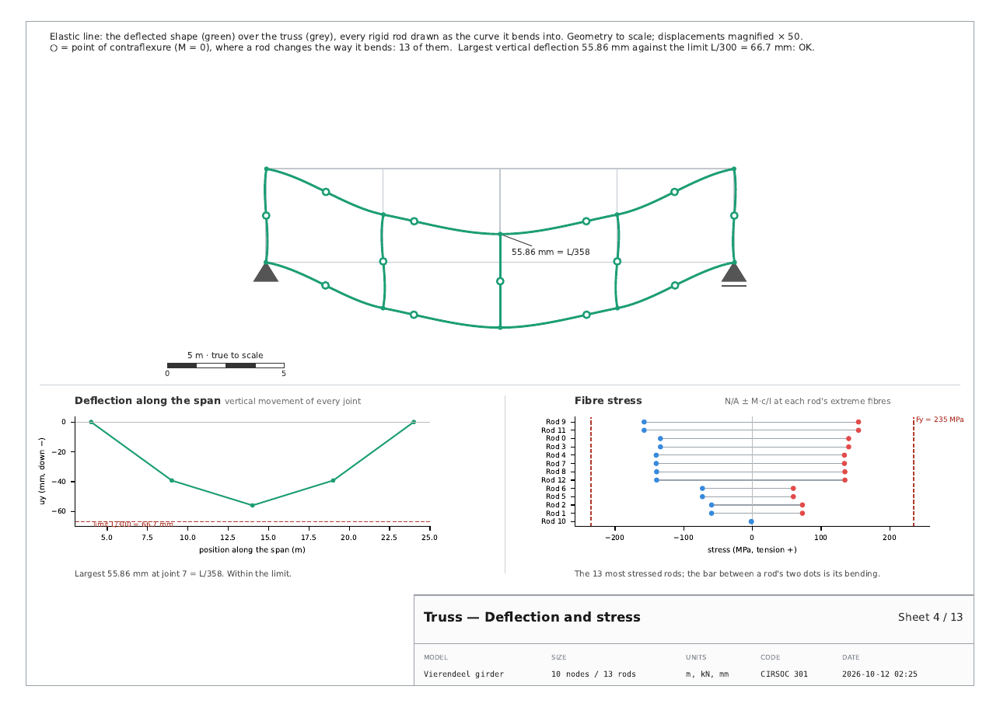
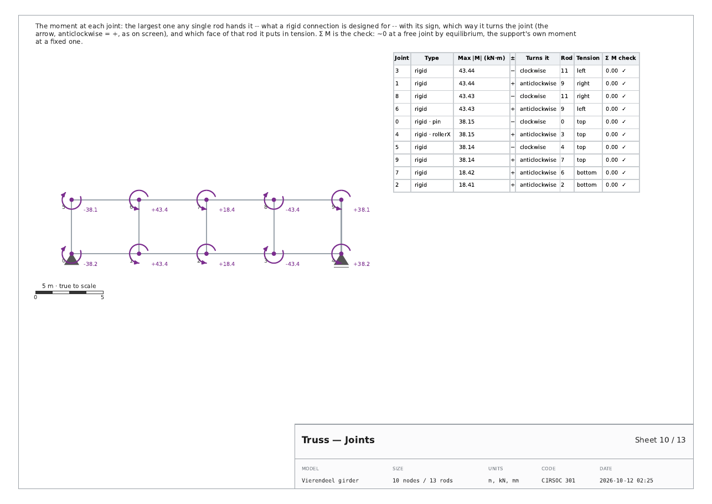
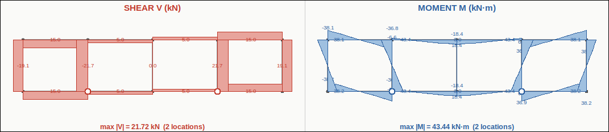

# v32 t 08 · 12-10-26

> *almost perfect i just have a criticism of the deformation sheet, it
> still does not have the elastic deformation graph with the
> contraflexural points. Also i just noticed there is not a sheet
> dedicated to the nodes, the nature of the maximum moment they
> experience and the sign.*

with a screenshot of the canvas: the Vierendeel's deflected shape, every
member an S-curve, a ○ at each point where the moment changes sign.

Both done, and a third thing found while doing them: **the Moment and
Shear sheets of t 06 and t 07 drew every lobe on the wrong face of its
member.**

---

## 1. The elastic line, with its points of contraflexure



**What it was.** Straight segments between the displaced joints. For a
pinned truss that is exact — a pin bar does not bend — but for a rigid
rod it threw away the point: a Vierendeel member bends in *double
curvature*, and the place where it changes the way it bends (M = 0) is
what the canvas marks with a ○.

**What it is.** The tab's own functions, not a re-derivation:

* `truss_math.deformed_shape_points` — each rigid rod as the
  Euler–Bernoulli cubic driven by its solved end displacements **and end
  rotations**, pin rods as straight lines;
* `find_zero_crossings` on the same `M(x)` the Moment sheet draws, placed
  with `deformed_point_at` on the same curve — so a ○ always sits where
  the moment diagram crosses zero. Crossings within 2 % of an end are
  left out, as on screen.

The Vierendeel example has **13** points of contraflexure; the sheet
counts them. A pinned truss has none, and the caption says why: every
member stays straight.

**At the screen's magnification.** Exported from the app, the elastic
line uses the slider's own factor (×50 by default), because that is the
picture it gets compared against — at the old automatic ×20 the S-bends
were too flat to see. A report written by a script, with no slider,
puts the biggest movement at 12 % of the span. If a large slider value
throws the shape past the drawing's margin, the view widens to hold it,
still to scale.

The small graph underneath that was titled "Elastic deformation" is
renamed **Deflection along the span**, which is what it is (each joint's
vertical movement against L/300), so the name belongs to the picture the
owner meant by it.

## 2. The Joints sheet



Every joint that carries moment, worst first:

| column | what it says |
|---|---|
| **Max \|M\|** | the largest moment any *one* rod hands the joint — what a rigid connection is designed for |
| **±** and **Turns it** | its sign, and which way it turns the joint: anticlockwise = +, the same circular arrow the canvas draws, also drawn on the sheet |
| **Rod** | which rod it comes from |
| **Tension** | which face of that rod, at that joint, the moment stretches — top, bottom, left or right |
| **Σ M check** | the sum of every rod's moment at the joint |

**Why the largest and not the sum.** By equilibrium, the rods' moments
at a free joint cancel: the sum reads ~0 at exactly the joints that work
hardest. So the sheet reports the largest single one as the design
number and keeps the sum as what it is, a check — ✓ at a free joint,
and at a fixed support the moment the support itself supplies, read
from the reactions.

**The tension face** comes from the rod's *internal* moment at that end
— `M(0)` at end A, `M(L)` at end B. Note that the solver's `Mb` is the
end action on the joint, *minus* the internal moment; using it directly
would have put the tension on the wrong face at every B end.

Only produced when some joint carries moment. The cover now names the
largest joint moment.

## 3. The Moment and Shear sheets were on the wrong face — fixed

The tab defines a member's +v side as `(-dy/L, dx/L)` on its **y-down**
canvas: for a rod drawn left to right that points *down*, the side a
sagging moment puts in tension. So the screen draws the moment diagram
on the **tension face** — the usual convention in Argentina.

t 06 applied the same formula to the report's **y-up** points, which
points the other way, and its docstring claimed the two matched. Every
lobe on the Shear and Moment sheets sat on the opposite face of its
member to the screen. `_Report.normal()` is now
`((yb - ya)/L, -(xb - xa)/L)`, and the sheets were checked against the
app's own view of the same model:



Sagging centre chords below, hogging corners above, verticals in double
curvature — lobe for lobe the same as the screen now. The Moment
caption says it in words: drawn on the face it puts in tension.

## 4. Tests

`tests/test_truss_pdf.py` goes from 52 to 64:

* every rigid rod is drawn as a curve that actually leaves its chord;
* every ○ lies on a sign change of that rod's `M(x)`, one ○ per crossing;
* a pinned truss has none and says its members stay straight;
* the slider's magnification is used when given; a big one stays on the
  drawing;
* **a sagging moment is drawn below a horizontal rod**, and for every rod
  of the model the report's normal maps back onto the screen's;
* a bending model gets a Joints sheet and a pinned one does not;
* each joint reports the largest single-rod moment, and free joints sum
  to zero;
* the arrow turns anticlockwise for + and clockwise for −, measured from
  the polyline's signed area, and the table says the same;
* the table's tension face points the same way as the Moment sheet's
  lobe at that joint;
* the cover names the biggest joint moment.

**Measured, 12-10-26**, Python 3.12 under Xvfb at 1600x1000:

```
pytest tests/ --ignore=tests/test_stereo_app.py
    3096 passed, 1 skipped in 596.49s
```

against 3084 passed / 1 skipped at the end of `t 07`.

## 5. The example reports

`REPORTS AND GUIDES/example_reports_v32_t08/` (moved from `…_t07`, which
git history keeps), regenerated through the app. The Vierendeel goes to
**13** sheets with the Joints sheet; the pinned examples stay at 9.

## 6. Files

| file | change |
|---|---|
| `apps/truss/truss_pdf.py` | `normal()` and the corrected band face; `contraflexure()`; `_deformed_panel` draws the elastic line; `joint_moments()`, `_moment_arc()`, `joints()`; `deform_scale`; `_table(fontsize=)`; the cover's joint line |
| `apps/truss/truss_app_design.py` | hands the report the slider's magnification |
| `tests/test_truss_pdf.py` | 52 → 64 tests |
| `USER_GUIDE.html` | the elastic line and the Joints sheet |
| `REPORTS AND GUIDES/example_reports_v32_t08/` | the example reports |
| `tools/build_release.py`, `BUILD_STAMP.txt` | `APP_ITERATION = 8` |
