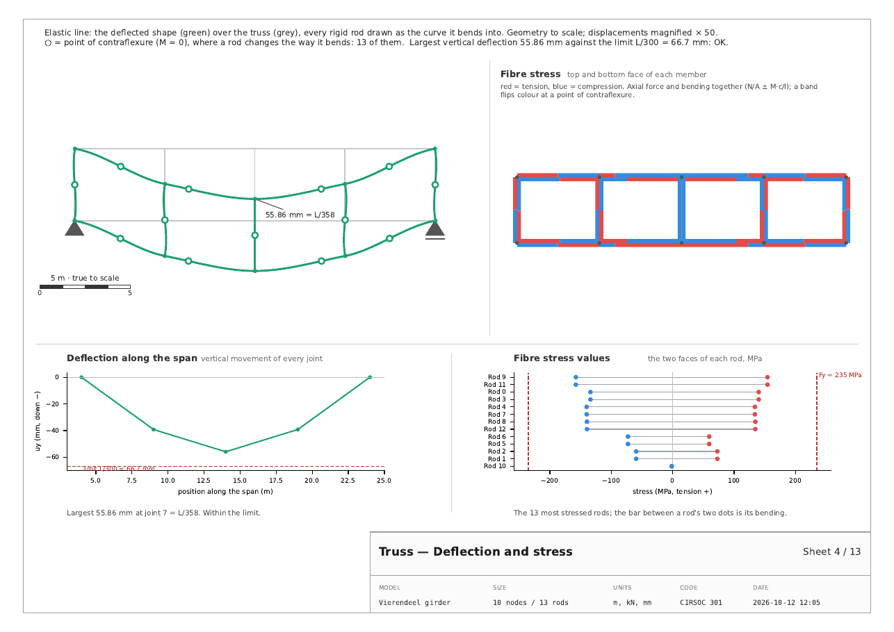
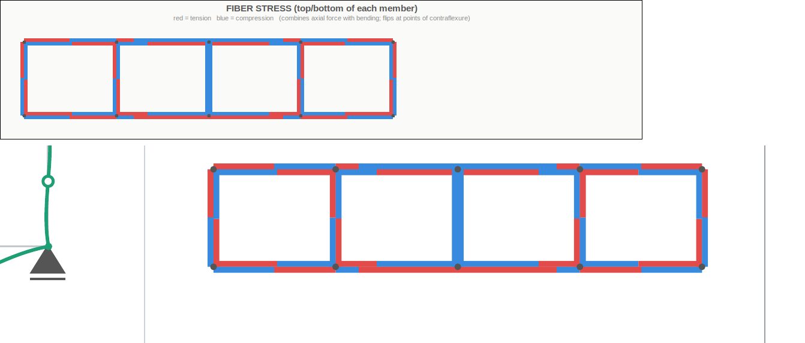

# v32 t 09 · 12-10-26

> *this is the fiber stress diagram, why is it missing from the pdf??
> please fix it.*

with a screenshot of the tab's *Compression/Tension fibers* view: the
structure with every rigid rod as two coloured bands, one per face, red
in tension and blue in compression, flipping at the points of
contraflexure.

---

## Why it was missing

In `t 06` the owner asked for "the fiber stress graph" on the deformation
sheet. What went there was a **ranked chart** of each rod's two extreme
fibre stresses — the numbers, not the picture. It was a misreading of
the request, and the screenshot made the difference plain.

## What the sheet carries now



Four pictures on one sheet, divided by a rule across and a rule down each
row:

| | left | right |
|---|---|---|
| **top** | the elastic line, with its points of contraflexure | **the fibre stress drawing** — new |
| **bottom** | deflection along the span | the fibre stress *values* (the old chart, renamed) |

The drawing is the tab's, rule for rule (`_draw_fiber_diagram`):

* every **rigid** rod as two bands of fixed width, `sigma_pos` on its +v
  face and `sigma_neg` on its −v face — `compute_fiber_stress`, N/A ±
  M·c/I, the same function the tab calls;
* each band cut at every sign change and coloured by the sign of each
  piece, so it flips exactly at a point of contraflexure, and a
  compressed member still shows red where its bending wins;
* every **pin** rod as one line in the colour of its axial force — it has
  no bending to separate its faces;
* the faces mapped onto the report's frame by `normal()`, the function
  `t 08` corrected, so the top band of a member on paper is its top band
  on screen.

The old chart stays, renamed **Fibre stress values**, under the drawing
it quantifies: the bands are a colour code and say nothing about size.

## Checked against the screen, not against a description of it



Every rigid rod's two faces, sampled at ten points along their length:
the colour the **canvas** drew there, read back with `find_overlapping`,
against the colour the **report** drew at the same visual spot. The
report's spot is found from the screen's own offset direction with y
flipped — not from `normal()` — so the check does not test the code with
itself.

**260 of 260 agree** on the Vierendeel.

Getting the check itself right took four attempts, each worth recording
because each was a property of the screen and not a fault in the report:

1. the support triangles are polygons too, so the first lookup searched
   the wrong drawing;
2. the canvas resized between drawing and reading (drawn 233 px tall,
   read at 259), so the test now reads where the app actually drew each
   joint off the canvas instead of rebuilding the transform;
3. two faces change sign at t = 0.503 and 0.480, so a sample at exactly
   mid-length sat on the boundary — samples within 3 px of a sign change
   are skipped;
4. in a full suite run the canvas came out small, and the tab's bands are
   a fixed 6 px whatever the zoom: near a joint one member's band covered
   its neighbour. The test now gives the canvas a proper size and stays
   out of the joint zones.

That is now `test_the_fibre_drawing_matches_the_screen_face_for_face`.

## Tests

`tests/test_truss_pdf.py` goes from 64 to 68:

* the sheet carries the drawing, with at least one band on each face of
  every rigid rod, both colours, and the values chart still present;
* the number of band pieces is two per rigid rod plus one per sign
  change — so every flip is drawn and nothing extra;
* a pinned truss draws each rod in its axial colour and says why;
* the screen-against-report comparison above.

`test_every_drawing_is_to_scale` now counts five equal-aspect drawings,
the fibre drawing being one.

**Measured, 12-10-26**, Python 3.12 under Xvfb at 1600x1000:

```
pytest tests/ --ignore=tests/test_stereo_app.py
    3100 passed, 1 skipped in 514.94s
```

against 3096 passed / 1 skipped at the end of `t 08`.

## Files

| file | change |
|---|---|
| `apps/truss/truss_pdf.py` | `_fibre_drawing_panel`, `FIBRE_BAND`; `deflection_and_stress` laid out two-by-two; `_deformed_panel(pad=)`; the values chart renamed |
| `tests/test_truss_pdf.py` | 64 → 68 tests |
| `USER_GUIDE.html` | the fibre stress drawing |
| `REPORTS AND GUIDES/example_reports_v32_t09/` | the example reports, regenerated |
| `tools/build_release.py`, `BUILD_STAMP.txt` | `APP_ITERATION = 9` |
