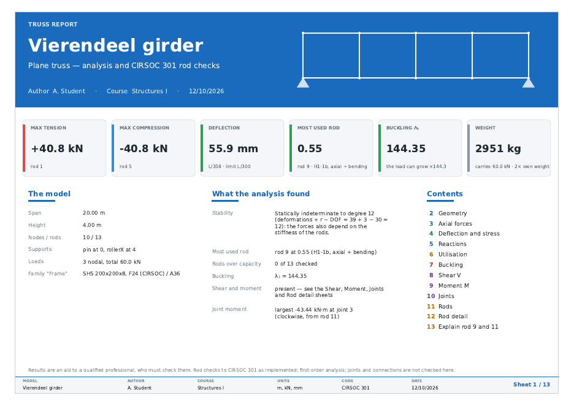
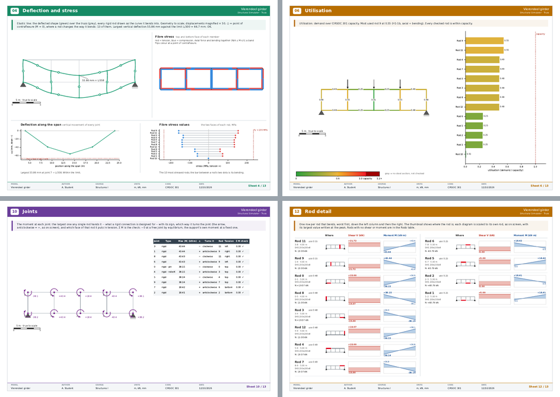

# v32 t 10 · 12-10-26

> *before building the zip with the update please polish the pdf
> presentation so it is more aesthetically pleaseing. provide an updated
> pdf of the vierendeel case please. ask any question you want in order
> to avoid mistakes*

Four questions were asked first, and answered:

| question | answer |
|---|---|
| Overall style | **Modern report**: a coloured header band per sheet, cards for the key numbers on the cover, larger headings, more colour |
| Captions | **Keep the full text**, typeset more cleanly |
| Language | **English**, as now |
| Title block | **Add author and course**: asked once, remembered, printed on every sheet |

Nothing the report *says* changed. Every number, drawing and sheet from
`t 09` is still there; this round changes how it looks.

---

## The cover

* A **blue title band**: TRUSS REPORT, the model's name at 26 pt, and
  *Author · Course · date* underneath, with the truss drawn in white
  beside it.
* **Six cards for the key numbers**: max tension, max compression,
  deflection, most used rod, buckling λ₁ and weight. Each has a coloured
  stripe that gives the verdict before the number is read:
  * deflection: green within L/300, red over it;
  * most used rod: green, amber above 0.9, red above 1.0;
  * λ₁: red below 1 (it buckles under the load as it stands), amber below
    2, green otherwise;
  * tension and compression: the screen's red and blue.
* **Three columns** underneath:
  * *The model*;
  * *What the analysis found*: stability, the most used rod, buckling,
    shear and moment, and the largest joint moment;
  * *Contents*, with each sheet's number in its chapter colour.

## Every other sheet

* **The header band** carries the sheet number in a white tile, the
  heading at 14 pt, and the model name on the right. Its colour says
  what kind of sheet it is:

  | colour | sheets |
  |---|---|
  | blue | the structure: geometry, axial forces, reactions |
  | green | deflection and stress |
  | amber | strength: utilisation, rods, rod detail, explain, plates |
  | red | buckling |
  | purple | the forces inside the members: shear, moment, joints |

* **The caption** sits in a tinted box under the band, with an accent bar
  in the chapter colour. The text is in full, as before, set at 7.8 pt
  with more line spacing, and wrapped to the box rather than to the
  paper.
* **The footer** replaces the ISO title block that sat in the
  bottom-right corner. It shows the model, author, course, units, code
  and date, plus *Sheet n / N*. With the title block gone, the layouts no
  longer have to work around that corner.
* **Tables** have a dark header row and zebra-striped body rows, with no
  grid lines. An OVER in the Use column is shown in bold red.
* **The Rods sheet** has a caption explaining its columns. It was the
  only sheet without one.

### Where each sheet's content goes now

Each sheet is still laid out on the same grid as before. `frame()` then
moves everything down by `CONTENT_DY = −0.070`, so it sits under the band
and clear of the footer. The same shift applies to every axes, text and
rule, so nothing on a sheet moves relative to anything else.

Three things sat low enough to collide after the shift and were moved:

| what | change |
|---|---|
| Utilisation colour key | now just above the footer, with the "grey = no steel section" note beside it rather than under it |
| Rod detail grid | starts at 0.880 with rows 0.088 tall, so the column headings clear a two-line caption and eight rows still clear the footer |
| Joints and Rods tables | tops lowered under the caption box |

The Explain column also gained three lines (`EXPLAIN_LINES` 49 → 52).
The Vierendeel's rod 9 and rod 11 checks now fit whole, with no
"… 2 more lines".

## The author and the course

* `apps/truss/truss_report_prefs.py` (new, no Tk) stores them in
  `~/.structural_simulator/truss_report.json`, next to the Stereo tab's
  PDF presets. You can point it elsewhere with `$TRUSS_REPORT_PREFS`.
* A damaged or missing file is read as two blanks, so it can never stop a
  report from being written.
* The first time you export a PDF from the window, a small dialog asks
  for both. **Save** remembers what you typed. **Cancel** remembers
  "none", so you are not asked on every export.
* To change them later: **Export ▾ → Report author and course…**.
* If a field is blank, the footer prints "—" rather than an empty box.
* A script calling `export_pdf(..., author=, course=)` gets the same
  result without the dialog.

## Tests

`tests/test_truss_pdf.py` has 12 new tests (15 cases, 80 tests in total):

* every sheet carries its band, its number and *Sheet n / N*, and every
  footer carries the author and the course; with none given, the footer
  prints "—";
* the band colours split into five chapters;
* the cover has all six cards, and λ₁ below 1 gets the red stripe;
* **nothing on any sheet runs into the band or the footer**: every text,
  axes and table is measured after rendering, on 4-bay and 12-bay
  Vierendeels. The 12-bay one has 37 rods, two rod tables side by side
  and two Rod detail sheets. Putting the colour key back at its old
  height makes this test fail, so it does catch a collision;
* the caption sits under the band;
* the prefs file round-trips, and survives bad JSON and the wrong JSON
  type;
* the tab passes the remembered author and course to the report;
* the dialog saves what was typed, and a first Cancel is remembered;
* the Export ▾ menu offers *Report author and course…*.

## Example reports

`REPORTS AND GUIDES/example_reports_v32_t10/` contains all eight reports
again, written by the app with the placeholder author *A. Student*,
course *Structures I*. The Vierendeel is `07_vierendeel.pdf`, 13 sheets.
