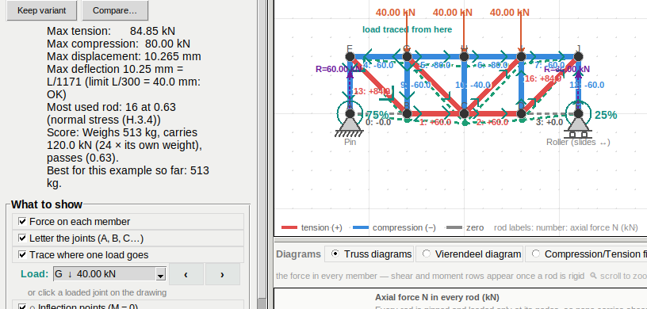

# v32 t 11 · 12-10-26

> *one more thing when i activate the trace where one load goes is
> working properly i think however i would like to be able to select the
> force that it is describing the path of.*

## Before

When you switched on *Trace where one load goes*, the trace chose the
load for you: the selected joint if it carried a load, otherwise the
biggest load in the model. It chose only at the moment the switch was
turned on, so selecting a different joint afterwards changed nothing.
Any edit dropped the trace, and the next ▶ Analyze did not bring it back
even though the switch was still on.

## Now

While the switch is on, a **Load** row appears under it. There are three
ways to pick the load to trace:

* **The list** shows every load as *joint · direction · size*, for
  example `G ↓ 40.00 kN`. The joint is named as the drawing names it,
  letter or number, and the size is in the selected units. Picking one
  traces it at once, and the status line says where it lands.
* **‹ ›** step to the previous or next load, wrapping round at the ends.
* **Clicking a loaded joint** on the drawing, with the Select tool,
  traces that joint's load. Clicking an unloaded joint only selects it,
  as before.

The trace now **remembers your choice**. After an edit and a new
▶ Analyze, it traces the same load again. If that load has been
deleted, it falls back to the old rule: the selected joint, otherwise the
biggest load.

The Load tool keeps one load per joint, so naming the joint names the
load. `truss_loadpath` (the superposition solve) is unchanged.

## "Force on each member" did nothing — fixed

> *are you sure the "force on each member" button is working properly??*

It was not. The switch had a variable and redrew the canvas when
clicked, but the drawing code never read the variable. Every rod was
always labelled with its number and its force, whatever the switch said.

Now, with the switch off, each rod shows **only its number**, so the rods
can still be told apart. The note in the legend changes to match:
*rod labels: number* instead of *number: axial force N*.

To check that nothing else in the box was broken the same way, every
switch in *What to show* was flipped on a solved model, comparing every
item on the canvas before and after. Each one changes the drawing:

* force on each member;
* letter the joints;
* inflection points;
* moment at rigid joints;
* deformed shape;
* colour by utilisation;
* hide zero-force rods, checked on the Pratt: the Vierendeel has no
  zero-force rod to hide.

## Tests

`tests/test_truss_loadpath.py` has 7 new tests (21 in total):

* the list shows every load and appears and disappears with the switch;
* picking from the list traces that load;
* ‹ › step through the loads and wrap round;
* clicking a loaded joint traces it;
* the choice survives an edit and a new solve;
* deleting the chosen load falls back to another and shortens the list.
* *Force on each member* off leaves only the rod numbers and changes the
  legend; on again brings the forces back.

`tests/test_truss_layout.py` no longer counts the chooser's three
controls as missing while the trace is off, since they are hidden on
purpose.
