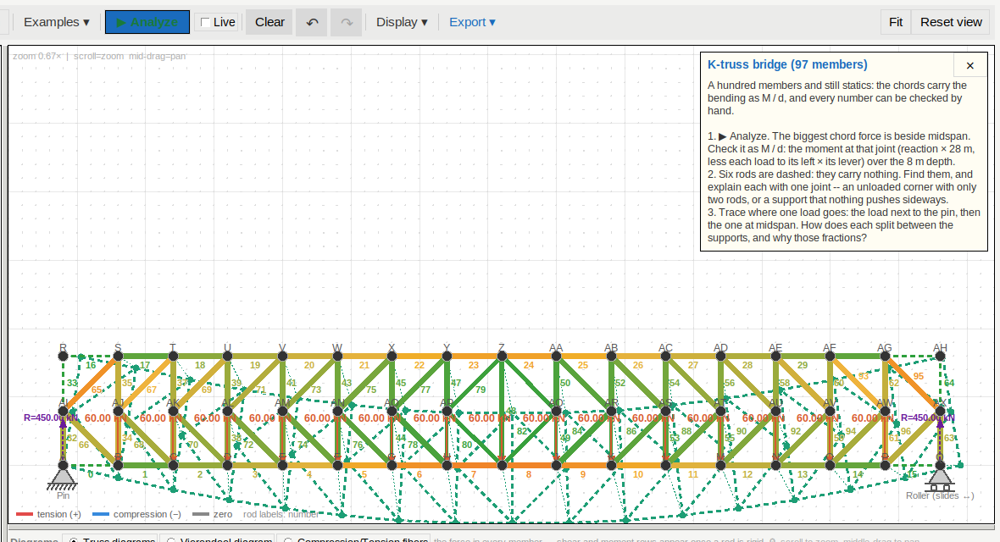
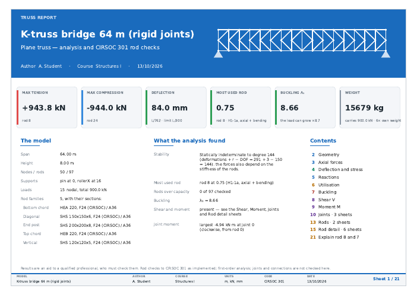

# v32 t 13 · 13-10-26

> *add the k-truss bridge to the examples menu*

> *please do also another aesthetic check on the pdf in the rigid case of
> the pdf there are some things to correct, but if you can make it even
> more presentable that would be great.*

with a screenshot of the rigid bridge's cover, its title running into
the truss drawn beside it.

## The K-truss bridge in the examples

There are two ways to open it:

* **Examples ▾ → K-truss bridge — 97 members, 64 m**, a direct item next
  to the Warren truss;
* *Browse the library…*, where it is the tenth entry, *K-truss bridge
  (97 members)*.

It opens **fitted to the window**. At the usual zoom most of a 64 m
bridge was off screen. The view is fitted only when a model doesn't
already fit, so the nine small examples open exactly as before; a test
checks both.

Like every example, it comes with a lesson. Its three questions are the
large-model protocol's hand checks in brief, and a test holds each one
to what the solver gives:

1. The biggest chord force is beside midspan and equals M / d (945 kN).
2. Six rods are dashed, and each is explained by one joint: an unloaded
   corner with two rods, or a support that nothing pushes sideways.
3. A load splits between the supports by the lever rule: 15/16 next to
   the pin, half each at midspan.

The bridge's report is in `example_reports_v32_t13/10_k_truss_bridge.pdf`
with the others.

## The aesthetic pass on the rigid report

All 21 sheets were looked at one by one. What was corrected:

| Sheet | Problem | Now |
|---|---|---|
| Cover | A long title ran under the truss drawing | The title is as large as fits beside the drawing: 26 pt, stepping down to 18, then over two lines. A short title keeps its 26 pt. |
| Footer, every sheet | The model's name was cut at 30 characters ("…(rigid joi") | up to 40 characters, then an ellipsis |
| Axial forces, Reactions | The web members ran through the "60.0 kN" load labels | Load labels sit on a white backing, centred over their arrows |
| Reactions | The arrows had no values; the table floated | Each arrow carries its value at the tail. The scale bar is centred between the supports so it is clear of both values, and the table sits to the right. |
| Deflection and stress | The "limit L/300" label was printed on the axis tick labels | It sits just above its dashed line, inside the graph, which leaves room under the line |
| Deflection and stress | The fibre-stress bands were heavy on a slender truss | Band width comes from the annotation scale |
| Buckling | Three modes side by side made three thin strips | On a slender truss the modes are stacked, each the full width of the sheet with its λ beside it; the second-order curve and its notes move down to suit |
| Joints | Moment arcs as big as a third of a 4 m panel ran into each other | An arc is at most a fifth of a typical member |

Every change is either limited to slender trusses or keeps a small
truss's sheets as they were. The two that also show on small trusses are
the reaction values on the arrows and the white backing behind load
labels; the Pratt and the Vierendeel were checked by eye.

## Tests

* `tests/test_truss_play.py` has 5 new tests (32 in total):
  * ten examples, each with a lesson;
  * one test for each of the bridge's three questions;
  * the bridge opens fully in view while small examples keep their
    zoom;
  * the Examples ▾ item loads the bridge with its lesson, and the
    library lists it.
* `tests/test_truss_pdf.py` has 4 new tests (6 cases):
  * the cover title never runs into the drawing, for a short, a long
    and a very long title; this fails when the title is allowed the
    full width again;
  * the footer keeps a 34-character name whole;
  * each reaction value is clear of the scale bar;
  * the limit label sits inside its graph.
