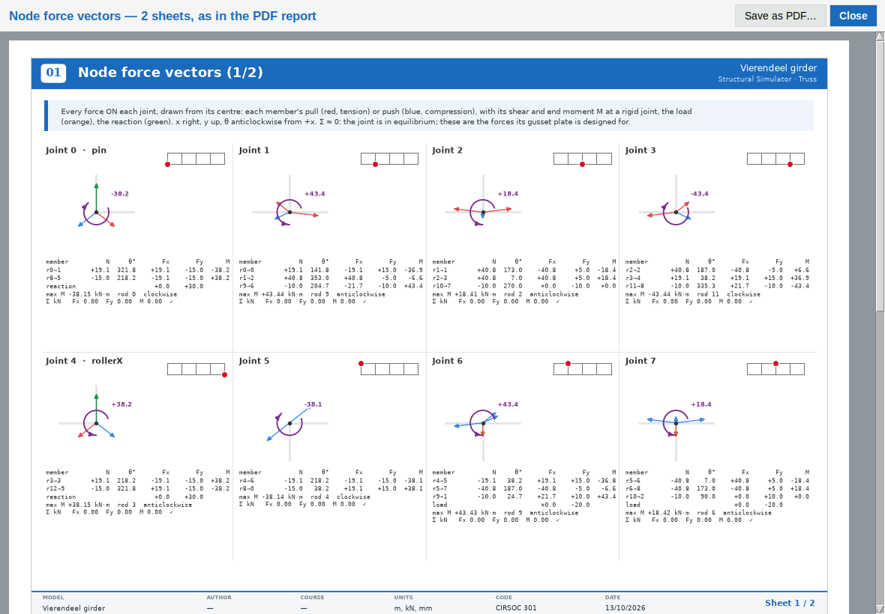
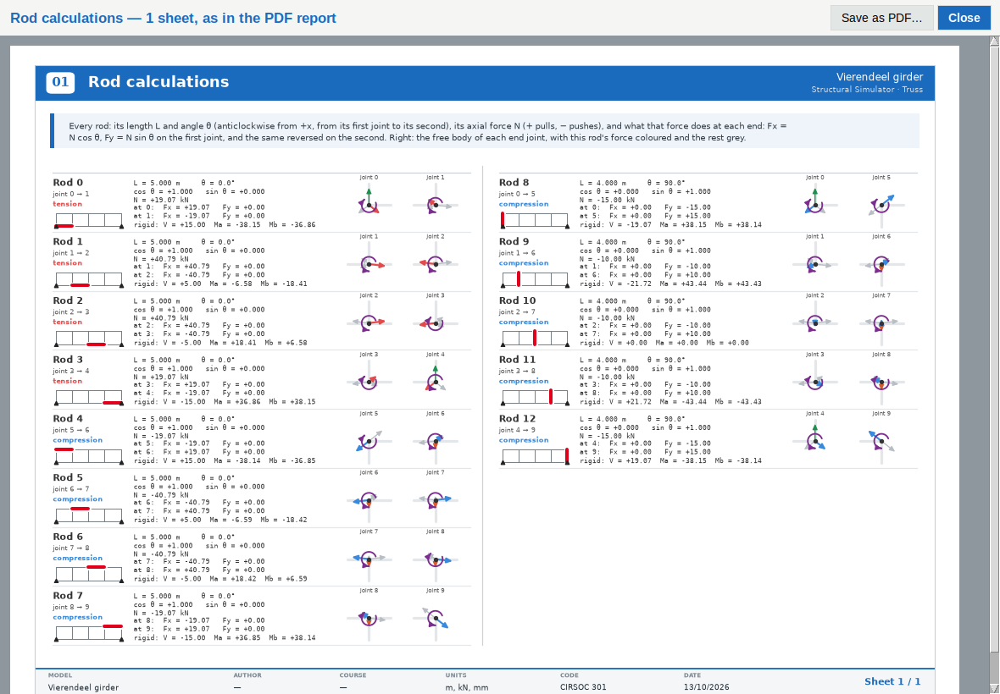

# v32 t 15 · 13-10-26

> *can you add a node member vector report sheet and a rod memeber repost
> sheet to the pdf documents please??*

> *the max momentm with the sign and arrow should be there in the cards
> also please update the apps ui to show the nodes and member rods like
> you ar doing for the pdf this version si so much better and clearer
> than the one in the app.*

The tab already had both reports, as windows: **Export ▾ → Node force
vectors…** and **Show me the working (rod calculations)…**. They are now
in the PDF as sheets, as cards. The two windows show those same cards.

## Node force vectors: a card per joint, eight to a sheet

Each card holds:

* **The joint**, its support if it has one, and a thumbnail locating it
  in the truss.
* **Its free-body diagram**: every force on the joint, drawn from its
  centre:
  * each member's pull in red (tension) or push in blue (compression),
    over a faint line showing that member's direction;
  * the load in orange, the reaction in green.
* **At a joint that carries moment, its maximum moment**: the largest
  one any single rod hands it, or the support's own at a fixed support.
  It is drawn as a purple **turning arrow** round the joint, anticlockwise
  for +, with its **signed value**, the convention of the Joints sheet.
* **The table**: each member (rod → the joint at its other end) with N,
  θ, Fx, Fy and, at a rigid joint, its end moment M. Then the load, the
  reaction, a line *max M −43.44 kN·m rod 11 clockwise*, and the sums
  ΣFx, ΣFy, ΣM with a ✓ when they close.

The numbers come from `compute_node_design_actions`, the same function
the window always used. This is the complete action of each member on
the joint: axial force, plus shear and end moment at a rigid joint, plus
the corner forces of any shear panel. So every card closes, including
on the Vierendeel and with plates.

## Rod calculations: a row per rod, sixteen to a sheet

Each row holds:

* the rod, its joints, whether it is in tension or compression, and its
  thumbnail;
* **L and θ** (anticlockwise from +x, from its first joint to its
  second), cos θ and sin θ;
* **N**, and what it does at each end: Fx = N cos θ, Fy = N sin θ on the
  first joint, the same reversed on the second;
* for a **rigid** rod, one more line with its shear V and end moments Ma
  and Mb. The free bodies beside it include them, so the row says so;
* the **free bodies of both end joints**, with this rod's force
  coloured, the others grey, and the joint's moment arrow.

## The same cards in the app

**Export ▾ → Node force vectors…** and **Show me the working (rod
calculations)…** now open a window showing exactly these sheets, drawn by
the report's own code at the window's width. The window and the PDF are
one drawing and cannot disagree.

* **Save as PDF…** writes just those sheets.
* The window uses the remembered author and course.
* On a hundred-member model the status line says it is drawing; the
  bridge takes about 5 s for its node cards and 10 s for its rod rows.

The old windows' own Tk free-body diagrams and Courier text boxes are
gone, along with their two drawing helpers. The Excel export keeps its
own pictures, `truss_reports.pil_draw_*`, untouched.

## Sheet counts

| | before | now | of which new |
|---|---|---|---|
| Pratt | 9 | 13 | 2 node + 2 rod |
| Vierendeel | 13 | 16 | 2 node + 1 rod |
| K-truss bridge, pinned | 10 | 24 | 7 + 7 |
| K-truss bridge, rigid | 21 | 35 | 7 + 7 |

The cover groups each run into one entry (*Node force vectors · 7
sheets*).

## Tests

* `tests/test_truss_pdf.py` has 7 new tests:
  * every joint gets a card whose sums close;
  * every member force on a card matches `compute_node_design_actions`;
  * a rigid joint's card carries its max moment, with the sign and
    which way it turns, and the purple turning arrows are drawn;
  * every rod gets a row, with N and the end components;
  * the node window shows the cards, one per joint, and every
    Vierendeel card has its max M; Save as PDF writes the same number
    of sheets;
  * the rod window shows one row per rod;
  * both windows ask for an analysis first.
* The test that keeps a pinned truss's report short now holds the two
  new chapters to their own budget: 8 joints and 16 rods to a sheet.
* `tests/test_truss_plates_app.py`: the equilibrium test reads the new
  window's cards. Every joint of a plated Vierendeel closes on ΣFx,
  ΣFy and ΣM, with the panel's forces listed.
* `tests/test_render_math_master.py`: the old Rod Calculations window
  drew its equations with `render_math`, which must bind each image to
  the window showing it. The new window shows rendered sheets instead,
  so the rule moved with it. The guard now checks that the card window
  binds its Tk images to itself. A new test builds the real window in a
  second Tk root, the arrangement that broke `render_math`, and opens
  it. Both tests fail with the `master` removed.
