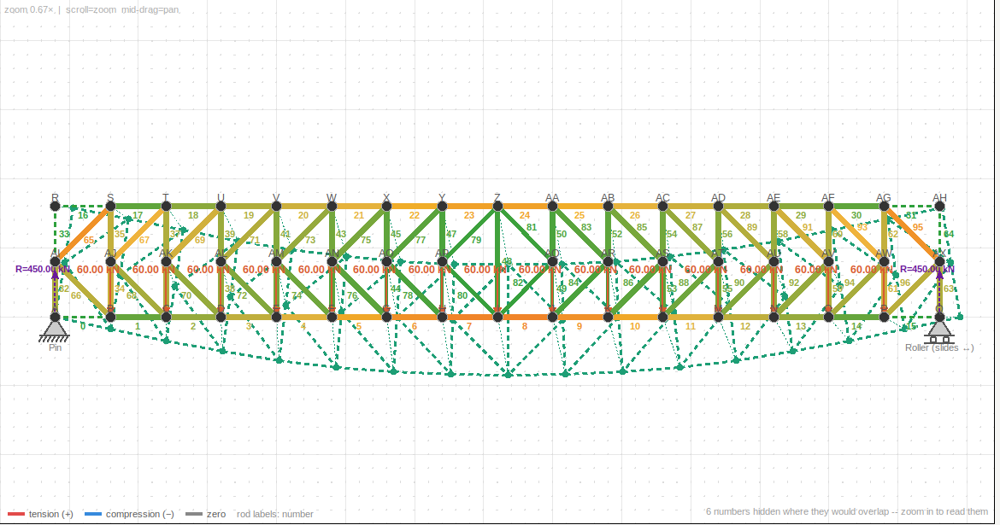
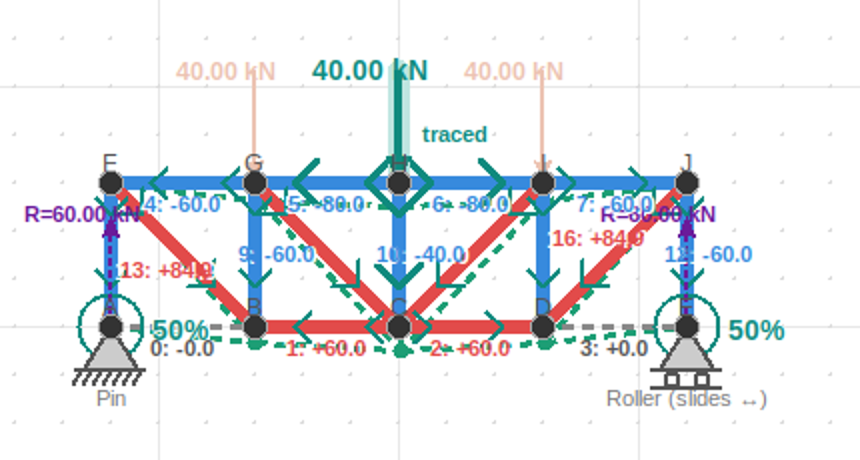
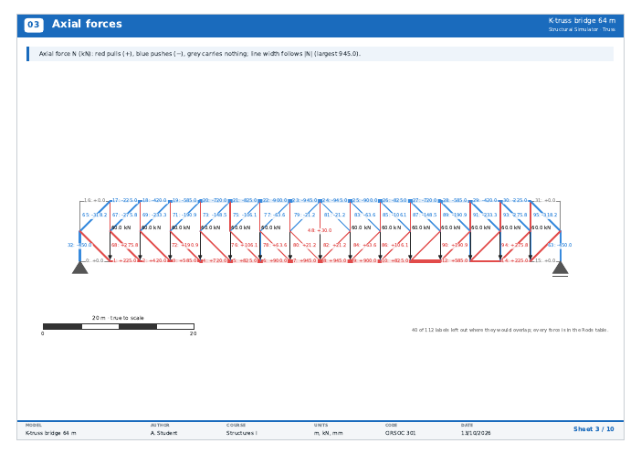

# Protocol: trusses of about a hundred members

> *build a protocol for structures with arround a hundred elements, mabye
> test an example and provide me with the pdf and excel so i can
> reproduce it too.*

This is the procedure for taking a large truss through the Truss tab:
building it, analysing it, checking it, reading the results and
reporting on it. It is worked through on a real example, a **64 m K-truss
bridge with 97 members**.

`tests/test_truss_large_model.py` runs every step automatically. If a
later change breaks the tab for a large model, that test fails before a
student does.

---

## The example: a K-truss bridge

The bridge is generated by `apps/truss/truss_large.py`,
`k_truss_bridge()`:

| | |
|---|---|
| Span | 64 m: 16 panels of 4 m |
| Depth | 8 m (span / 8) |
| Joints | 50: 17 bottom, 17 top, 16 at mid-height |
| Members | 97: 32 chords, 33 vertical pieces, 32 diagonals |
| Supports | pin at the left end, roller at the right |
| Loads | 60 kN at each of the 15 inner bottom joints (900 kN in total, the deck hanging from the bottom chord) |
| Families | top chord HEB 220, bottom chord HEA 220, end posts SHS 200×200×8, verticals SHS 120×120×5, diagonals SHS 150×150×6, all F24 steel |

Every vertical except the middle one is split at mid-height. From each
mid-height joint, two diagonals run to the top and the bottom of the next
vertical, pointing away from midspan. That is the "K".

### The files, to reproduce it

Everything is in `REPORTS AND GUIDES/large_model_protocol_v32_t12/`:

| File | What it is |
|---|---|
| `K-truss bridge 64 m.xlsx` | the model and its results; **Export ▾ → Import model from Excel…** rebuilds it exactly |
| `K-truss bridge 64 m.pdf` | the report, 10 sheets |
| `K-truss bridge 64 m (rigid joints).xlsx` | the same bridge with every joint welded |
| `K-truss bridge 64 m (rigid joints).pdf` | its report, 21 sheets: the heaviest report the tab writes |

Both PDFs were written the same way you will reproduce them: import the
Excel file, ▶ Analyze, **Export PDF report…**. The report takes its title
from the file's name.

---

## Step 1: Plan before you draw

A hundred members drawn one click at a time is an afternoon, and one
missing diagonal is a mechanism. So:

1. **Count first.** Write down j (joints), m (members) and r (reaction
   components: a pin is 2, a roller 1, a fixed support 3).
   * m + r = 2j: statically determinate. Statics alone gives every force.
   * m + r < 2j: a **mechanism**. It cannot carry load, whatever the
     sections.
   * m + r > 2j: indeterminate. That is fine, but the forces then depend
     on the sections.

   For the bridge: 97 + 3 = 2 × 50, determinate.
2. **Choose the families before the members.** Give each kind of member
   its own family: top chord, bottom chord, end posts, verticals,
   diagonals. A family is what you resize later, so one family per job
   makes that a single change. The bridge's end posts are their own
   family because they carry the full 450 kN reaction, and the first
   design, with them as plain verticals, failed at 1.33.
3. **Decide where the loads go.** The deck of a through-truss hangs from
   the bottom chord; a roof's purlins sit on the top chord. Loads go on
   joints.

## Step 2: Build it, in Excel rather than by hand

For anything regular, build the model in a spreadsheet and import it:

1. Export any small truss (**Export ▾ → Export model and results to
   Excel…**) and open its **Model** sheet. That is the template.
2. Fill in its blocks. Do not reorder the columns.

   | Block | Columns |
   |---|---|
   | `[PROFILES]` | name, E_GPa, A_cm2, I_cm4, Fy_MPa, Fu_MPa, r_gyr_cm, c_cm, catalog, material |
   | `[NODES]` | idx, x_m, y_m (metres, y up) |
   | `[RODS]` | idx, a, b, E_GPa, A_cm2, I_cm4, conn (`pin` or `rigid`), profile, udl_kNm, udl_rotation_deg |
   | `[SUPPORTS]` | node, type (`pin`, `rollerX`, `rollerY`, `fixed`) |
   | `[NODE_LOADS]` | node, fx_kN, fy_kN (fy positive downwards) |

   A formula column makes the regular parts quick. For example, x =
   4 × (panel number) for a whole chord, and a = i, b = i + 1 for its
   members.
3. **Export ▾ → Import model from Excel…** rebuilds the truss. The status
   line says how many joints and rods it read: check that against your
   count.

The bridge's file round-trips exactly. The protocol test exports it,
clears the tab and imports it again. It checks that every joint, member,
family, support and load is identical and that every force agrees.

## Step 3: Read the stability line before analysing

The line under ▶ Analyze shows the count from step 1 as soon as the model
exists:

> Statically determinate (m + r − 2j = 97 + 3 − 2×50 = 0): statics alone
> gives every force.

If it says **mechanism**, stop. ▶ Analyze will animate how it moves;
add the member or support it is missing before going further.

## Step 4: Analyse

▶ Analyze. On a hundred members it is still instant:

| | pinned | rigid joints |
|---|---|---|
| the solve itself | 3 ms | — |
| ▶ Analyze, including redrawing everything | 90 ms | 250 ms |
| tracing one load | 50 ms | 65 ms |

*Live* (re-solve while you edit) stays usable at this size.

## Step 5: Read the canvas, decluttered



With every label on, a hundred members is a hundred numbers. Use
**Analyse → What to show**:

1. **Force on each member: off.** Only the rod numbers stay. The forces
   are in the results panel and the report.
2. **Colour by utilisation: on.** The whole bridge reads at once: the
   midspan chords in amber are the hardest working, the diagonals near
   the middle in green carry least.
3. **Hide zero-force rods**, if you only want what is working. The
   pinned bridge has six zero-force rods: the end panel of each chord at
   each end (four), and the top halves of the two end posts. Their
   corner joints have no load and only two members each, which is why
   they carry nothing.
4. **Deformed shape** is switched on by each ▶ Analyze. Lower its × to
   about 10 on a long span, or switch it off while you read forces.
5. **Zoom in to read numbers.** The canvas leaves out any label that
   would land on another and says how many in the bottom-right corner;
   zooming in brings them back.
6. **Trace where one load goes.** Pick the load from the **Load** list
   (or ‹ ›, or click a loaded joint). Its arrow turns teal and the others
   fade. The load next to the pin lands 15/16 on the pin, as statics
   says it should.



## Step 6: Check the numbers by hand

A hundred numbers from a program are not a result until a few have been
checked. These take a line each:

| Check | By hand | The tab |
|---|---|---|
| Reactions | 15 × 60 / 2 = **450 kN** each | 450.00 and 450.00 |
| Sum of reactions | = total load, **900 kN** | Reactions sheet Σ = 900.00 |
| Biggest chord force | M at the joint next to midspan ÷ depth = (450 × 28 − 60 × (24 + 20 + … + 4)) / 8 = 7560 / 8 = **945 kN** | ±945.0 kN (rods 7, 8, 23, 24) |
| End post | carries the whole reaction, **450 kN** | −450.0 kN (rod 32) |
| Symmetry | a symmetric bridge under symmetric load: each member equals its mirror image | every one of the 97 pairs agrees |
| Deflection | within L/300 = 213 mm | 84 mm = L/761 |

If any check disagrees, find out why before reading anything else.
Usual causes:

* a load typed with the wrong sign (fy is positive *downwards*);
* a joint that was meant to be shared but is two joints on top of each
  other;
* a support of the wrong type.

## Step 7: Size the families

1. **Analyse → Colour by utilisation** and the Utilisation sheet rank the
   members.
2. Change the section of the family that fails or is wasteful (**Section
   → Material and section**, applied to the family), then ▶ Analyze
   again.
3. Aim for the worst member of each family between about 0.6 and 0.9.

The bridge as delivered:

| Family | Max force | Max utilisation |
|---|---|---|
| Top chord HEB 220 | −945 kN | 0.65 |
| Bottom chord HEA 220 | +945 kN | 0.73 |
| End post SHS 200×200×8 | −450 kN | 0.39 |
| Vertical SHS 120×120×5 | +225 / −165 kN | 0.49 |
| Diagonal SHS 150×150×6 | ±318 kN | 0.69 |

Buckling: λ₁ = 2.34 pinned and 8.66 rigid, so both have room before
overall buckling. The utilisation already covers each member buckling on
its own.

## Step 8: Pinned or rigid?

Welding the joints changes the chord forces by **under 1 %** (945 kN
pinned, 944 kN rigid), and the largest bending moment is about 5 kN·m.
A deep, triangulated truss carries its load by axial force either way.
That is why the pinned model is a fair one, and why its report is 10
sheets instead of 21. The protocol test asserts the 1 %.

## Step 9: Report

**Export PDF report…**. What to expect at this size:

| | pinned | rigid joints |
|---|---|---|
| Sheets | 10 | 21 |
| Time to write | about 5 s | about 20 s |
| Extra sheets | — | Shear V, Moment M, Joints (3 sheets), Rod detail (6 sheets) |



What the report does differently for a large, slender model. None of
this changes a small truss's report:

* **Slender trusses are drawn across the sheet.** A truss more than five
  times as long as it is deep gets arrows, supports, dimensions and
  margins sized from its depth instead of its length. Before, the
  bridge's load arrows were longer than the bridge was deep, and its
  margins confined it to the middle 60 % of the sheet. It now uses about
  three quarters of the sheet width.
* **Labels never print on top of each other.** As on the canvas, the
  most important labels are placed first (the biggest forces, the
  worst utilisations), and any label that would overlap one already
  placed is left out. The sheet says how many and where to read them.
  The bridge's Axial forces sheet keeps 72 of its 112 labels and notes
  that every force is in the Rods table.
* **Reactions, Utilisation and Joints put the drawing on top**, full
  width, with the table or the ranking underneath. The Joints table is
  split into two halves.
* **The cover groups repeated sheets**: *Rod detail · 6 sheets*, *Joints ·
  3 sheets*. The rigid report's contents fit in one column instead of
  running off the edge.
* **The title comes from the file**: an imported model is named after
  its Excel file instead of "Truss".

Then **Export ▾ → Export model and results to Excel…**: 1.5 s, and the
file you can hand on to someone else to reproduce the model.

## Checklist

- [ ] Counted j, m, r; m + r ≥ 2j
- [ ] One family per kind of member
- [ ] Built in Excel and imported; the status line's counts match
- [ ] Stability line read: not a mechanism
- [ ] ▶ Analyze
- [ ] Forces off, colour by utilisation on, deformed shape toned down
- [ ] Reactions = total load, half each if symmetric
- [ ] One chord force checked as M / d
- [ ] Symmetric model, symmetric forces
- [ ] Deflection within L/300
- [ ] Every family between about 0.6 and 0.9; nothing over 1.0
- [ ] λ₁ comfortably above 1
- [ ] PDF exported; the hidden-label notes point where the values are
- [ ] Excel exported, and the file re-imports to the same model

## Regenerating the files

```
python3 -c "from apps.truss import truss_large as tl; m = tl.k_truss_bridge()"
```

`k_truss_bridge(panels=16, bay=4.0, depth=8.0, load=60.0, rigid=False)`
builds the bridge, and `hand_checks()` gives the step 6 numbers for the
same arguments. Any even number of panels works, so a longer or shorter
bridge is one argument away.
